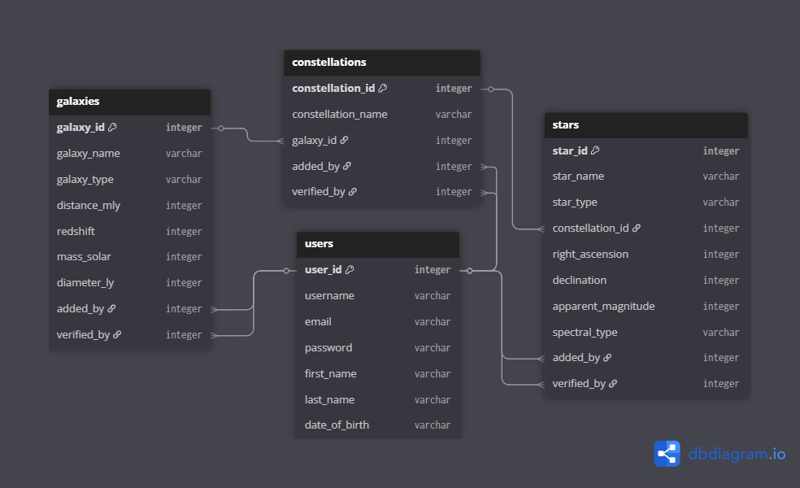
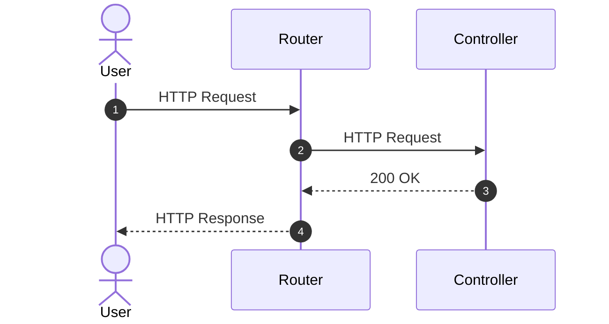

# starzz-laravel


This project is a production-style REST API built with Laravel, designed to demonstrate clean backend architecture and real-world API design patterns.

The API manages a database of fictional galaxies, constellations, and stars.

Mermaid diagrams illustrate request flows, allowing readers to quickly grasp the architecture while chapter walkthroughs provide deeper insight.

## Features

- REST API built with Laravel

## The Dataset

Here is a diagram to describe the tables and their relationships:



Stars are located in constellations, which are in turn located in galaxies.

The `galaxies`, `constellations` and `stars` tables contain the additional
fields `added_by` and `verified_by` to indicate the id of the users who made
the finding and verified it, respectively.

The database was created in MySQL.  The scripts to create the tables and
load the dummy data are included in `assets` for reference.

Our assumption is that we are working with a legacy database that cannot easily be altered.

## The Application

This project was created in Visual Studio Code.  It uses PHP, Composer, Laravel and MySQL.

First we enable several PHP extensions.  These will be needed to build our Laravel application.
In `php.ini`, enable:

    extension=curl
    extension=fileinfo
    extension=intl
    extension=mbstring
    extension=openssl
    extension=pdo_mysql

We then create our project:

```bash
composer global require laravel/installer
laravel new starzz-laravel
```

All code committed at each chapter is available with the commit message of the chapter name.

### Chapter 1: Setting up the routes

#### Overview

This chapter sets up the foundation of the Laravel application and demonstrates the basic routing and controller structure. It shows how requests flow from the routers to the controllers and how endpoints are defined using the MVC pattern. Hardcoded responses are used to verify routing, providing a clear view of how controllers handle HTTP requests. By the end, theRc project has a working skeleton API that illustrates the architecture and request flow.



#### Endpoints

|     Endpoint                | Method | Description                                              | Response |
|-----------------------------|--------|----------------------------------------------------------|----------|
| `/api/constellations`       | GET    | Returns *Successfully called getConstellationList()*     | 200 OK   |
| `/api/constellations/{id}`  | GET    | Returns *Successfully called getConstellation(id)*       | 200 OK   |
| `/api/constellations`       | POST   | Returns *Successfully called registerConstellation()*    | 200 OK   |
| `/api/constellations/{id}`  | PUT    | Returns *Successfully called updateConstellation(id)*    | 200 OK   |
| `/api/constellations/{id}`  | DELETE | Returns *Successfully called deleteConstellation(id)*    | 200 OK   |
| `/api/galaxies`             | GET    | Returns *Successfully called getGalaxyList()*            | 200 OK   |
| `/api/galaxies/{id}`        | GET    | Returns *Successfully called getGalaxy(id)*              | 200 OK   |
| `/api/galaxies`             | POST   | Returns *Successfully called registerGalaxy()*           | 200 OK   |
| `/api/galaxies/{id}`        | PUT    | Returns *Successfully called updateGalaxy(id)*           | 200 OK   |
| `/api/galaxies/{id}`        | DELETE | Returns *Successfully called deleteGalaxy(id)*           | 200 OK   |
| `/api/stars`                | GET    | Returns *Successfully called getStarList()*              | 200 OK   |
| `/api/stars/{id}`           | GET    | Returns *Successfully called getStar(id)*                | 200 OK   |
| `/api/stars`                | POST   | Returns *Successfully called registerStar()*             | 200 OK   |
| `/api/stars/{id}`           | PUT    | Returns *Successfully called updateStar(id)*             | 200 OK   |
| `/api/stars/{id}`           | DELETE | Returns *Successfully called deleteStar(id)*             | 200 OK   |
| `/api/users`                | GET    | Returns *Successfully called getUserList()*              | 200 OK   |
| `/api/users/{id}`           | GET    | Returns *Successfully called getUser(id)*                | 200 OK   |
| `/api/users`                | POST   | Returns *Successfully called registerUser()*             | 200 OK   |
| `/api/users/{id}`           | PUT    | Returns *Successfully called updateUser(id)*             | 200 OK   |

*A Postman collection for all routes is included in* `assets/starzz-laravel.postman_collection.json`

#### Sample Responses

GET /api/constellations
```json
{
    "text": "Successfully called getConstellationList()"
}
```

GET /api/constellations/100

```json
{
    "text": "Successfully called getConstellation(100)"
}
```

GET /api/galaxies

```json
{
    "text": "Successfully called getGalaxyList()"
}
```

GET /api/galaxies/100

```json
{
    "text": "Successfully called getGalaxy(100)"
}
```

GET /api/stars

```json
{
    "text": "Successfully called getStarList()"
}
```

GET /api/stars/100

```json
{
    "text": "Successfully called getStar(100)"
}
```

GET /api/users

```json
{
    "text": "Successfully called getUserList()"
}
```

GET /api/users/100

```json
{
    "text": "Successfully called getUser(100)"
}
```

<details>

<summary>Chapter Walkthrough</summary>


Laravel supports the MVC (Model-View-Controller) pattern. In our application, routes map incoming HTTP requests to the controller methods responsible for handling them.

By default, Laravel configures web routing through `routes/web.php`. For example, the default welcome route returns an HTML view. However, Laravel controllers are not limited to returning views; they can also return JSON responses.

In `bootstrap/app.php`:

```php
...
->withRouting(
    web: __DIR__.'/../routes/web.php',
    commands: __DIR__.'/../routes/console.php',
    health: '/up',
)
...
```

The `web` parameter registers the application's web routes. Requests matching those routes are dispatched to the corresponding route handlers.

Since we want to build a REST API instead of relying only on web routes, we register `routes/api.php` by adding:

```php
api: __DIR__.'/../routes/api.php',
```

Laravel automatically applies the `/api` prefix to routes defined in this file. Therefore, a route defined with the path `/constellations` is accessible under `/api/constellations`.

Our application manages several resources. Instead of placing all route definitions in one file, we organize them into separate files, one per resource. The main `routes/api.php` file includes these files:

```php
...
require __DIR__.'/api/constellation.php';
require __DIR__.'/api/galaxy.php';
require __DIR__.'/api/star.php';
require __DIR__.'/api/user.php';
```

For example, `routes/api/constellation.php` defines the routes for constellation-related requests:

```php
...
Route::prefix('constellations')->group(function () {
    Route::get('/', [ConstellationController::class, 'getConstellationList']);
    Route::get('/{id}', [ConstellationController::class, 'getConstellation']);
...
```

The `Route::prefix('constellations')` group applies the `constellations` prefix to the routes inside it. Combined with Laravel's automatic `/api` prefix, these routes expose the following endpoints:

- `GET /api/constellations/` invokes `ConstellationController::getConstellationList`.
- `GET /api/constellations/{id}` invokes `ConstellationController::getConstellation`, where `{id}` is a route parameter.

In `app/Http/Controllers/ConstellationController.php`:

```php
...
class ConstellationController extends Controller
{
    public function getConstellationList(): array
    {
        return ["message" => "Successfully called getConstellationList()"];
    }

    public function getConstellation(string $id): array
    {
        return ["message" => "Successfully called getConstellation({$id})"];
    }
...
```

This controller defines the methods that handle the two constellation routes. For now, each method returns a simple array containing a message. Laravel automatically serializes the returned array into a JSON response, allowing us to verify that the routing and controller dispatch work correctly.

The other resource route files and controllers follow a similar pattern.

In the next chapter, we introduce the persistence layer using Eloquent and connect our application to a MySQL database.

</details>

## Conclusion

**starzz-laravel** demonstrates a complete, production-style Laravel REST API built incrementally — from setting up routes.
