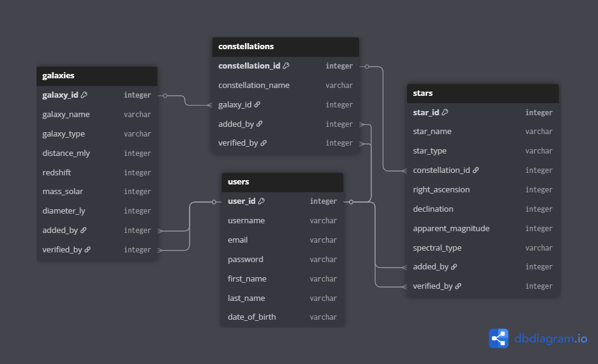
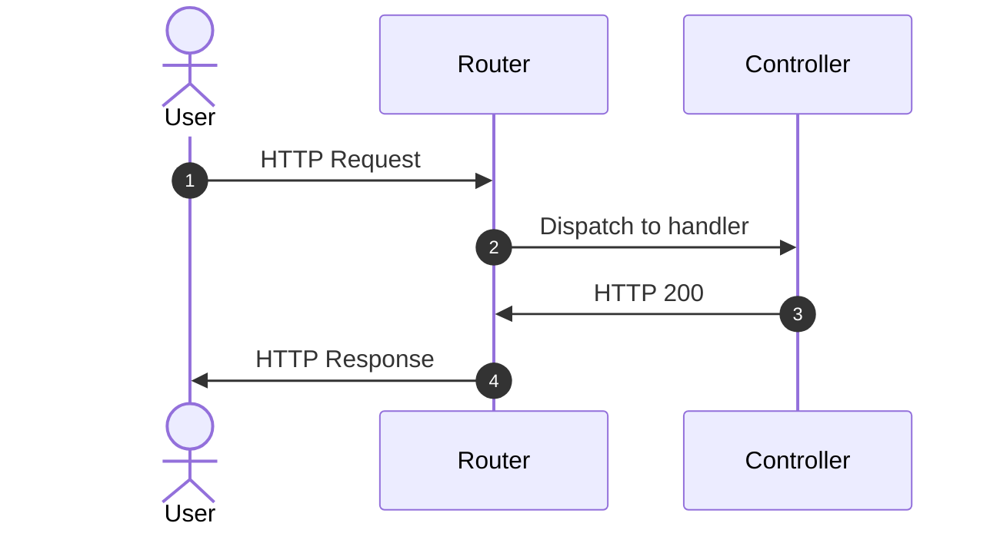
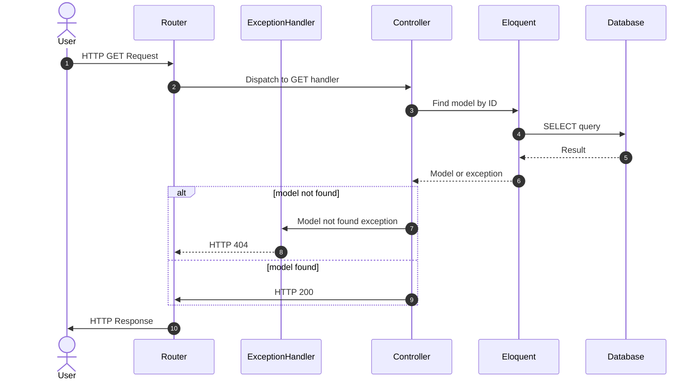
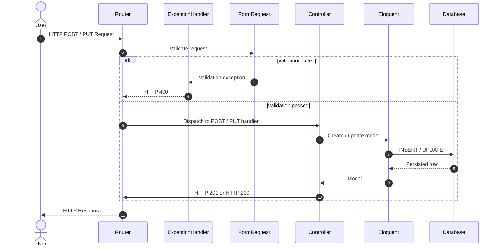
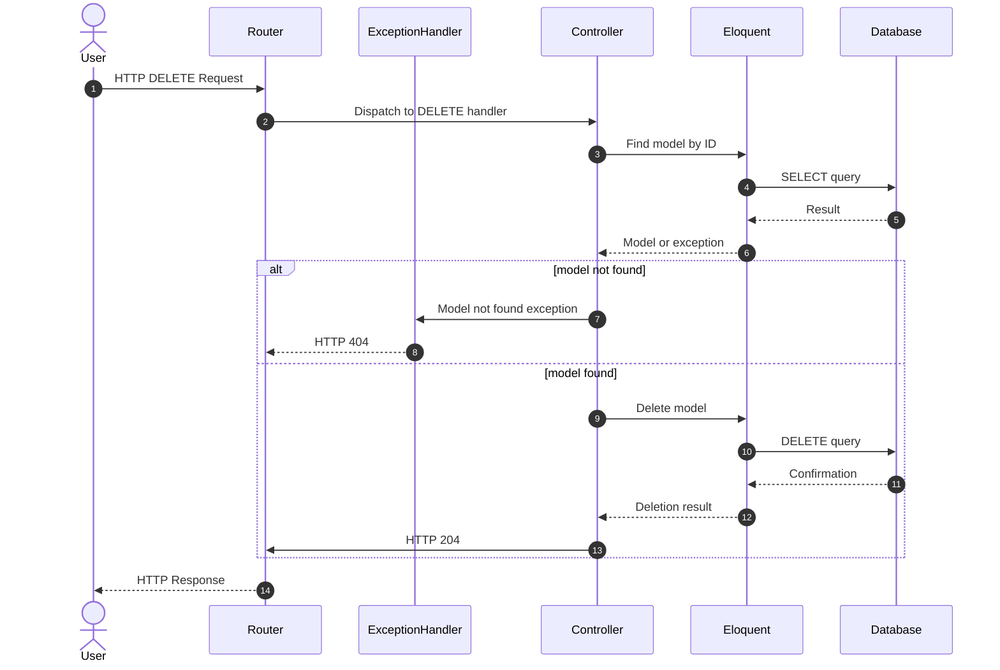

# starzz-laravel


This project is a production-style REST API built with Laravel, designed to demonstrate clean backend architecture and real-world API design patterns.

The API manages a database of fictional galaxies, constellations, and stars.

Mermaid diagrams illustrate request flows, allowing readers to quickly grasp the architecture while chapter walkthroughs provide deeper insight.

## Features

- REST API built with Laravel
- MySQL database interaction via Eloquent
- Data handling with Form Requests and API Resources

## The Dataset

Here is a diagram to describe the tables and their relationships:



Stars are located in constellations, which are in turn located in galaxies.

The `galaxies`, `constellations` and `stars` tables contain the additional
fields `added_by` and `verified_by` to indicate the id of the users who made
the finding and verified it, respectively.

The database was created in MySQL.  The scripts to create the tables and
load the dummy data are included in `assets` for reference.

Our assumption is that we are working with a legacy database that cannot easily be altered.

## The Application

This project was created in Visual Studio Code.  It uses PHP, Composer, Laravel and MySQL.

First we enable several PHP extensions.  These will be needed to build our Laravel application.
In `php.ini`, enable:

    extension=curl
    extension=fileinfo
    extension=intl
    extension=mbstring
    extension=openssl
    extension=pdo_mysql

We then create our project:

```bash
composer global require laravel/installer
laravel new starzz-laravel
```

All code committed at each chapter is available with the commit message of the chapter name.

### Chapter 1: Setting up the routes

#### Overview

This chapter sets up the foundation of the Laravel application and demonstrates the basic routing and controller structure. It shows how requests flow from the routers to the controllers and how endpoints are defined using the MVC pattern. Hardcoded responses are used to verify routing, providing a clear view of how controllers handle HTTP requests. By the end, the project has a working skeleton API that illustrates the architecture and request flow.



#### Endpoints

|     Endpoint                | Method | Description                                              | Response |
|-----------------------------|--------|----------------------------------------------------------|----------|
| `/api/constellations`       | GET    | Returns *Successfully called getConstellationList()*     | 200 OK   |
| `/api/constellations/{id}`  | GET    | Returns *Successfully called getConstellation(id)*       | 200 OK   |
| `/api/constellations`       | POST   | Returns *Successfully called registerConstellation()*    | 200 OK   |
| `/api/constellations/{id}`  | PUT    | Returns *Successfully called updateConstellation(id)*    | 200 OK   |
| `/api/constellations/{id}`  | DELETE | Returns *Successfully called deleteConstellation(id)*    | 200 OK   |
| `/api/galaxies`             | GET    | Returns *Successfully called getGalaxyList()*            | 200 OK   |
| `/api/galaxies/{id}`        | GET    | Returns *Successfully called getGalaxy(id)*              | 200 OK   |
| `/api/galaxies`             | POST   | Returns *Successfully called registerGalaxy()*           | 200 OK   |
| `/api/galaxies/{id}`        | PUT    | Returns *Successfully called updateGalaxy(id)*           | 200 OK   |
| `/api/galaxies/{id}`        | DELETE | Returns *Successfully called deleteGalaxy(id)*           | 200 OK   |
| `/api/stars`                | GET    | Returns *Successfully called getStarList()*              | 200 OK   |
| `/api/stars/{id}`           | GET    | Returns *Successfully called getStar(id)*                | 200 OK   |
| `/api/stars`                | POST   | Returns *Successfully called registerStar()*             | 200 OK   |
| `/api/stars/{id}`           | PUT    | Returns *Successfully called updateStar(id)*             | 200 OK   |
| `/api/stars/{id}`           | DELETE | Returns *Successfully called deleteStar(id)*             | 200 OK   |
| `/api/users`                | GET    | Returns *Successfully called getUserList()*              | 200 OK   |
| `/api/users/{id}`           | GET    | Returns *Successfully called getUser(id)*                | 200 OK   |
| `/api/users`                | POST   | Returns *Successfully called registerUser()*             | 200 OK   |
| `/api/users/{id}`           | PUT    | Returns *Successfully called updateUser(id)*             | 200 OK   |

*A Postman collection for all routes is included in* `assets/starzz-laravel.postman_collection.json`

#### Sample Responses

GET /api/constellations
```json
{
    "text": "Successfully called getConstellationList()"
}
```

GET /api/constellations/100

```json
{
    "text": "Successfully called getConstellation(100)"
}
```

GET /api/galaxies

```json
{
    "text": "Successfully called getGalaxyList()"
}
```

GET /api/galaxies/100

```json
{
    "text": "Successfully called getGalaxy(100)"
}
```

GET /api/stars

```json
{
    "text": "Successfully called getStarList()"
}
```

GET /api/stars/100

```json
{
    "text": "Successfully called getStar(100)"
}
```

GET /api/users

```json
{
    "text": "Successfully called getUserList()"
}
```

GET /api/users/100

```json
{
    "text": "Successfully called getUser(100)"
}
```

<details>

<summary>Chapter Walkthrough</summary>


Laravel supports the MVC (Model-View-Controller) pattern. In our application, routes map incoming HTTP requests to the controller methods responsible for handling them.

By default, Laravel configures web routing through `routes/web.php`. For example, the default welcome route returns an HTML view. However, Laravel controllers are not limited to returning views; they can also return JSON responses.

In `bootstrap/app.php`:

```php
...
->withRouting(
    web: __DIR__.'/../routes/web.php',
    commands: __DIR__.'/../routes/console.php',
    health: '/up',
)
...
```

The `web` parameter registers the application's web routes. Requests matching those routes are dispatched to the corresponding route handlers.

Since we want to build a REST API instead of relying only on web routes, we register `routes/api.php` by adding:

```php
api: __DIR__.'/../routes/api.php',
```

Laravel automatically applies the `/api` prefix to routes defined in this file. Therefore, a route defined with the path `/constellations` is accessible under `/api/constellations`.

Our application manages several resources. Instead of placing all route definitions in one file, we organize them into separate files, one per resource. The main `routes/api.php` file includes these files:

```php
...
require __DIR__.'/api/constellation.php';
require __DIR__.'/api/galaxy.php';
require __DIR__.'/api/star.php';
require __DIR__.'/api/user.php';
```

For example, `routes/api/constellation.php` defines the routes for constellation-related requests:

```php
...
Route::prefix('constellations')->group(function () {
    Route::get('/', [ConstellationController::class, 'getConstellationList']);
    Route::get('/{id}', [ConstellationController::class, 'getConstellation']);
...
```

The `Route::prefix('constellations')` group applies the `constellations` prefix to the routes inside it. Combined with Laravel's automatic `/api` prefix, these routes expose the following endpoints:

- `GET /api/constellations/` invokes `ConstellationController::getConstellationList`.
- `GET /api/constellations/{id}` invokes `ConstellationController::getConstellation`, where `{id}` is a route parameter.

In `app/Http/Controllers/ConstellationController.php`:

```php
...
class ConstellationController extends Controller
{
    public function getConstellationList(): array
    {
        return ["message" => "Successfully called getConstellationList()"];
    }

    public function getConstellation(string $id): array
    {
        return ["message" => "Successfully called getConstellation({$id})"];
    }
...
```

This controller defines the methods that handle the two constellation routes. For now, each method returns a simple array containing a message. Laravel automatically serializes the returned array into a JSON response, allowing us to verify that the routing and controller dispatch work correctly.

The other resource route files and controllers follow a similar pattern.

In the next chapter, we introduce the persistence layer using Eloquent and connect our application to a MySQL database.

</details>

### Chapter 2: Setting up the database

#### Overview

This chapter introduces the persistence layer and connects the application to a MySQL database.  Models and relationships are defined.  Validation, exception handling, and structured response patterns are also included, making the API fully functional with proper separation of concerns.

##### HTTP GET



##### HTTP POST/PUT



##### HTTP DELETE



#### Updated Endpoints

|     Endpoint                | Method | Description                                              | Response       |
|-----------------------------|--------|----------------------------------------------------------|----------------|
| `/api/constellations`       | GET    | Returns the list of constellations                       | 200 OK         |
| `/api/constellations/{id}`  | GET    | Returns the constellation with the ID of *id*            | 200 OK         |
| `/api/constellations`       | POST   | Creates a new constellation record                       | 201 Created    |
| `/api/constellations/{id}`  | PUT    | Updates the constellation with the ID of *id*            | 200 OK         |
| `/api/constellations/{id}`  | DELETE | Deletes the constellation with the ID of *id*            | 204 No Content |
| `/api/galaxies`             | GET    | Returns the list of galaxies                             | 200 OK         |
| `/api/galaxies/{id}`        | GET    | Returns the galaxy with the ID of *id*                   | 200 OK         |
| `/api/galaxies`             | POST   | Creates a new galaxy record                              | 201 Created    |
| `/api/galaxies/{id}`        | PUT    | Updates the galaxy with the ID of *id*                   | 200 OK         |
| `/api/galaxies/{id}`        | DELETE | Deletes the galaxy with the ID of *id*                   | 204 No Content |
| `/api/stars`                | GET    | Returns the list of stars                                | 200 OK         |
| `/api/stars/{id}`           | GET    | Returns the star with the ID of *id*                     | 200 OK         |
| `/api/stars`                | POST   | Creates a new star record                                | 201 Created    |
| `/api/stars/{id}`           | PUT    | Updates the star with the ID of *id*                     | 200 OK         |
| `/api/stars/{id}`           | DELETE | Deletes the star with the ID of *id*                     | 204 No Content |
| `/api/users`                | GET    | Returns the list of users                                | 200 OK         |
| `/api/users/{id}`           | GET    | Returns the user with the ID of *id*                     | 200 OK         |
| `/api/users`                | POST   | Creates a new user record                                | 201 Created    |
| `/api/users/{id}`           | PUT    | Updates the user with the ID of *id*                     | 200 OK         |

*The Postman collection in* `assets/starzz-laravel.postman_collection.json` *has been updated to the
format of requests used in this chapter.*

*A Note on Deletion* - The application provides *DELETE* endpoints and implements cascade delete for constellations (i.e. deleting a parent constellation also deletes its children stars) and galaxies (i.e. deleting a parent galaxy also deletes its children constellations and their children stars), but **does not** provide a *DELETE* endpoint for users.  This is a deliberate design decision:

- Users are referenced by galaxies, constellations, and stars (`addedBy` and `verifiedBy`).
- Cascading delete through these relationships would risk data loss and long transactional operations.
- The existing database schema cannot be modified to add a soft-delete flag (`isActive`), so soft deletion is not possible.
- Therefore, user deletion is intentionally disabled to preserve historical data integrity.

#### Sample Responses

GET /api/constellations

```json
[
    {
        "constellationId": 1,
        "constellationName": "Pleiades"
    },
    {
        "constellationId": 2,
        "constellationName": "Orion"
    }
]
```

GET /api/constellations/100

```json
{
    "constellationId": 100,
    "constellationName": "Cassiopeia",
    "galaxy": {
        "galaxyId": 1,
        "galaxyName": "Andromeda"
    },
    "addedBy": {
        "userId": 10,
        "username": "mike14288"
    },
    "verifiedBy": {
        "userId": 37,
        "username": "centwhistle45939"
    }
}
```

GET /api/galaxies

```json
[
    {
        "galaxyId": 1,
        "galaxyName": "Andromeda"
    },
    {
        "galaxyId": 2,
        "galaxyName": "Poseidon"
    }
]
```

GET /api/galaxies/100

```json
{
    "galaxyId": 100,
    "galaxyName": "Valhalla",
    "galaxyType": "Barred Spiral",
    "distanceMly": 5096,
    "redshift": 4,
    "massSolar": 5434403,
    "diameterLy": 647254,
    "addedBy": {
        "userId": 15,
        "username": "rtavener27922"
    },
    "verifiedBy": {
        "userId": 62,
        "username": "kchatres44202"
    }
}
```

GET /api/stars

```json
[
    {
        "starId": 1,
        "starName": "Sol"
    },
    {
        "starId": 2,
        "starName": "Rigel"
    }
]
```

GET /api/stars/100

```json
{
    "starId": 100,
    "starName": "Centaur",
    "starType": "red dwarf star",
    "constellation": {
        "constellationId": 38,
        "constellationName": "Cans Minor"
    },
    "rightAscension": 10,
    "declination": 78,
    "apparentMagnitude": -12,
    "spectralType": "O",
    "addedBy": {
        "userId": 1,
        "username": "ebalducci29128"
    },
    "verifiedBy": {
        "userId": 89,
        "username": "ogarriock20720"
    }
}
```

GET /api/users

```json
[
    {
        "userId": 1,
        "username": "ebalducci29128"
    },
    {
        "userId": 2,
        "username": "ldilloway50275"
    }
]
```

GET /api/users/100

```json
{
    "userId": 100,
    "username": "tperazzo50392",
    "email": "torey.perazzo@yahoo.com",
    "firstName": "Torey",
    "lastName": "Perazzo",
    "dateOfBirth": "1998-05-26"
}
```

<details>

<summary>Chapter Walkthrough</summary>

To persist and retrieve data, we now introduce a persistence layer. In Laravel applications,
this is typically achieved using Eloquent on top of a relational database.  In our case,
it is our **starzz** database on MySQL.

To allow our application to interact with the database, we would first need to configure our
database connection.  `config/database.php` has an associative array to define multiple connections; for MySQL, it is:

```php
...
'mysql' => [
    'driver' => 'mysql',
    'url' => env('DB_URL'),
    'host' => env('DB_HOST', '127.0.0.1'),
    'port' => env('DB_PORT', '3306'),
    'database' => env('DB_DATABASE', 'laravel'),
    'username' => env('DB_USERNAME', 'root'),
    'password' => env('DB_PASSWORD', ''),
...
```

It refers to several environment variables; we define these variables in our `.env` file:

    DB_CONNECTION=mysql
    DB_HOST=127.0.0.1
    DB_PORT=3306
    DB_DATABASE=starzz
    DB_USERNAME=<your database's username>
    DB_PASSWORD=<your database's password>

We now create our code to interact with our database.

Eloquent allows us to work with database tables in an object-oriented way.  We add classes to abstract tables, and we define their relationships with other tables.  In `app/Models`, we create these classes.  An example class is `Constellation`:

```php
...
class Constellation extends Model
{
    protected $table = 'constellations';

    protected $primaryKey = 'constellation_id';

    protected $fillable = ['constellation_name', 'galaxy_id', 'added_by', 'verified_by',];

    public $timestamps = false;

    public function galaxy(): BelongsTo
    {
        return $this->belongsTo(Galaxy::class, 'galaxy_id', 'galaxy_id');
    }

    public function addedBy(): BelongsTo
    {
        return $this->belongsTo(User::class, 'added_by', 'user_id');
    }

    public function verifiedBy(): BelongsTo
    {
        return $this->belongsTo(User::class, 'verified_by', 'user_id');
    }
    
    public function stars(): HasMany
    {
        return $this->hasMany(Star::class, 'constellation_id', 'constellation_id');
    }
}
```

`$table` and `$primaryKey` correspond to the table's name and primary key, respectively.  `$fillable` lists the columns allowed for mass assignment through *create* and *update*.  `$timestamps` is set to `false` to indicate that the table has no fields for Laravel timestamps.  `galaxy()`, `addedBy()`, `verifiedBy()` and `stars()` are functions that define the table's relationships with other tables.

Whenever we send data as part of responses, we usually don't send raw models from our database.
We create mappings from our models to custom objects, and send those objects instead.  These
custom objects are known as data transfer objects.  In Laravel, we refer to them as *API Resources*.

API Resources are returned to the user as JSON documents wrapped inside a `data` element:

```json
{
    "data": {
        <key>: <value>
    }
}
```

We can remove the `data` wrapper to only have:

```json
{
    <key>: <value>
}
```

In `app/Providers/AppServiceProvider.php` we modify `boot()` to:

```php
public function boot(): void
{
    JsonResource::withoutWrapping();
}
```

We now create a folder `app/Http/Resources` to contain our API Resource classes.  An example class is `ConstellationSummaryResource`:

```php
...
class ConstellationSummaryResource extends JsonResource
{
    public function toArray(Request $request): array
    {
        return [
            'constellationId' => $this->constellation_id,
            'constellationName' => $this->constellation_name,
        ];
    }
}
```

It defines `toArray()` that returns an associative array based on properties of the underlying model.

Another example is `ConstellationDetailResource`:

```php
class ConstellationDetailResource extends JsonResource
{
    public function toArray(Request $request): array
    {
        return [
            'constellationId' => $this->constellation_id,
            'constellationName' => $this->constellation_name,
            'galaxy' => new GalaxySummaryResource($this->galaxy),
            'addedBy' => new UserSummaryResource($this->addedBy),
            'verifiedBy' => new UserSummaryResource($this->verifiedBy),
        ];
    }
}
```

This class is similar to `ConstellationSummaryResource`; the returned associative array has additional fields to display the parent galaxy, and the adder and verifier.  These fields are themselves API Resources, and are created using the underlying model's relationships.

We also have a custom object to accept JSON input when processing requests to add or update constellation.  In Laravel, we refer to it as a *Form Request*.  Form Requests validate incoming data before the controller runs.  Controllers then call `validated()` that returns only the fields that passed.

We now create a folder `app/Http/Requests` to contain our Form Request classes.  An example class is `StoreConstellationRequest`:

```php
...
class StoreConstellationRequest extends FormRequest
{
    public function authorize(): bool
    {
        return true;
    }

    public function rules(): array
    {
        return [
            'constellationName' => ['required', 'string', 'max:100'],
            'galaxyId' => ['required', 'integer', 'exists:galaxies,galaxy_id'],
            'adderId' => ['required', 'integer', 'exists:users,user_id'],
            'verifierId' => ['nullable', 'integer', 'exists:users,user_id'],
        ];
    }
}
```

`rules()` returns an array specifying validation rules on the fields.  `authorize()` determines whether the currently authenticated user is permitted to perform the requested action before validation runs.  We set it to always return `true` for now because we have no special authorization logic.

The other classes in the `app/Models`, `app/Http/Resources` and `app/Http/Requests` folders follow a similar logic.

Whenever our application processes requests, errors may occur, e.g. a request for a nonexistent
constellation.  Laravel throws exceptions to convey information about these events.  We do this with exception handling.  We may want to customize Laravel's default exception handling.  In `bootstrap/app.php`:

```php
...
    ->withExceptions(function (Exceptions $exceptions): void {
        $exceptions->render(function (NotFoundHttpException $exception, Request $request) {
            if ($request->is('api/*')) {
                return response()->json([
                    'message' => 'Not found.',
                ], 404);
            }
        });
        $exceptions->render(function (ValidationException $exception, Request $request) {
            if ($request->is('api/*')) {
                return response()->json([
                    'message' => $exception->getMessage(),
                    'errors' => $exception->errors(),
                ], 400);
            }
        });
        $exceptions->shouldRenderJsonWhen(function (Request $request, Throwable $e) {
            return $request->is('api/*') || $request->expectsJson();
        });
    })
...
```

When Laravel throws `NotFoundHttpException`, our application responds with HTTP 404 and a message similar to "not found".  When Laravel throws `ValidationException`, our application responds with HTTP 400 and a message listing the validation errors.  Any other exception returns HTTP 500 as JSON. The response includes the stack trace only when `APP_DEBUG=true`.

Another validation we can add is numeric `id` validation on endpoints that require ids.  For example, when our application receives **GET** `/api/constellations/xyz`, a constellation with an id of `xyz` is guaranteed to be nonexistent.  To save a database query, we can put the validation in the route definition so Laravel immediately throws `NotFoundHttpException` on non-numeric id.

We define the route groupings in `routes/api.php` (we define the route prefixes here, instead of in the route files):

```php
...
Route::prefix('constellations')->group(__DIR__ . '/api/constellation.php');
Route::prefix('galaxies')->group(__DIR__ . '/api/galaxy.php');
Route::prefix('stars')->group(__DIR__ . '/api/star.php');
Route::prefix('users')->group(__DIR__ . '/api/user.php');
```

Routes defined in `routes/api/constellation.php` have the prefix `/constellations`, and so on.

And in `routes/api/constellation.php`:

```php
...
Route::get('/', [ConstellationController::class, 'getConstellationList']);
Route::post('/', [ConstellationController::class, 'registerConstellation']);

Route::where(['id' => '[0-9]+'])->group(function () {
    Route::get('/{id}', [ConstellationController::class, 'getConstellation']);
    Route::put('/{id}', [ConstellationController::class, 'updateConstellation']);
    Route::delete('/{id}', [ConstellationController::class, 'deleteConstellation']);
});
```

Note that the last 3 routes belong to a group that requires `id` to conform to the regular expression `[0-9]+`.

Finally, we rewrite our `ConstellationController.php`:

```php
...
class ConstellationController extends Controller
{
    public function getConstellationList(): AnonymousResourceCollection
    {
        return ConstellationSummaryResource::collection(
            Constellation::all()
        );
    }

    public function getConstellation(int $id): ConstellationDetailResource
    {
        return new ConstellationDetailResource(
            Constellation::with(['galaxy', 'addedBy', 'verifiedBy'])
                ->findOrFail($id)
        );
    }

    public function registerConstellation(StoreConstellationRequest $request): JsonResponse
    {
        $data = $request->validated();

        $constellation = Constellation::create([
            'constellation_name' => $data['constellationName'],
            'galaxy_id' => $data['galaxyId'],
            'added_by' => $data['adderId'],
            'verified_by' => $data['verifierId'] ?? null,
        ]);

        return $this->getConstellation($constellation->constellation_id)
            ->response()
            ->setStatusCode(201);
    }
...
```

We now return our API Resources.  Where appropriate, we require our Form Requests and integer id for function parameters.

The other classes in the `app/Http/Controllers` folder follow a similar logic.

Now that we’ve finished setting up the database, our app is starting to grow.  With more pieces working together, it’s easy to accidentally break something when we add new features. That’s why it’s a good idea to start writing **unit tests** now — they help us make sure each part works on its own and keep everything running smoothly as the project grows.

</details>

## Conclusion

**starzz-laravel** demonstrates a complete, production-style Laravel REST API built incrementally — from setting up routes to database interaction.
