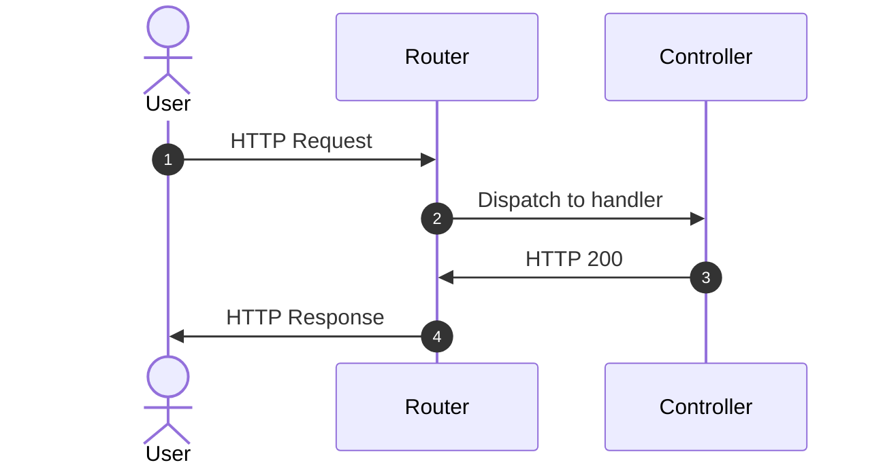
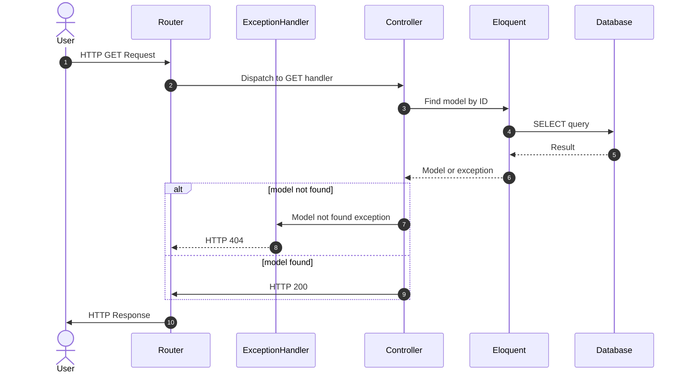
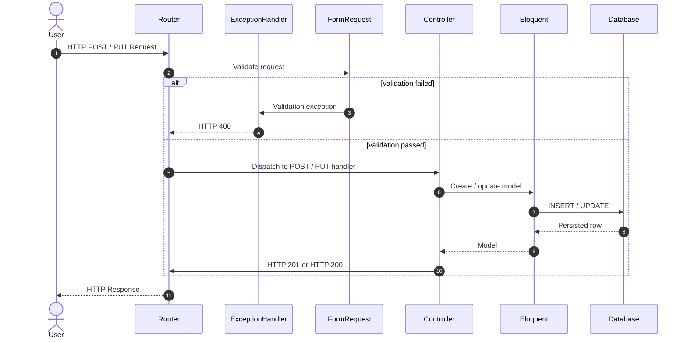
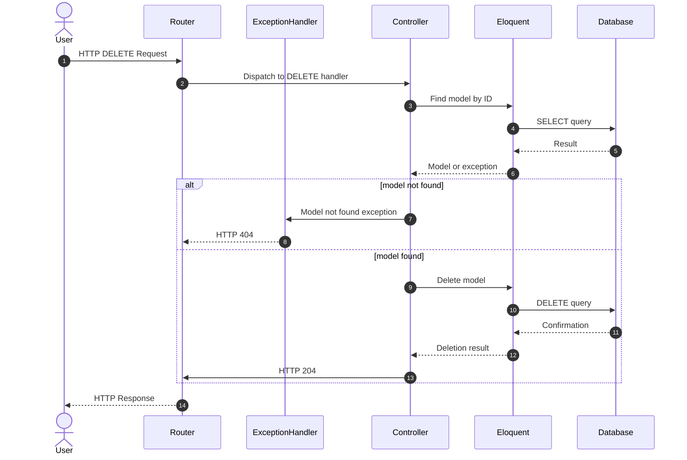
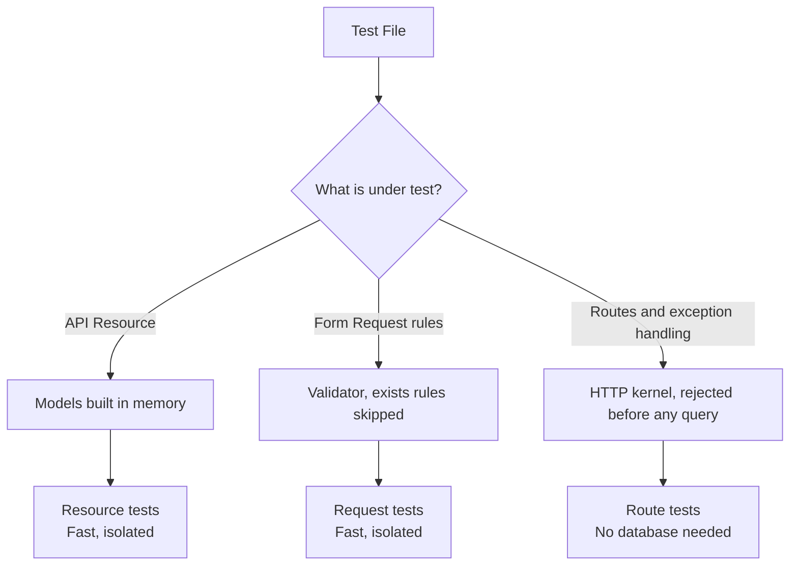
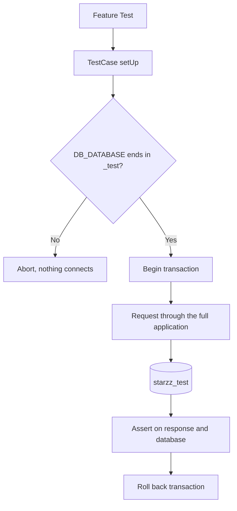
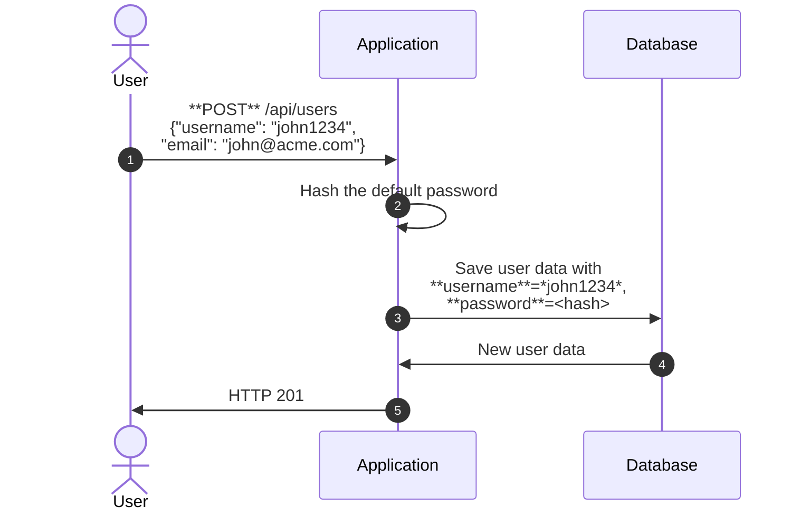
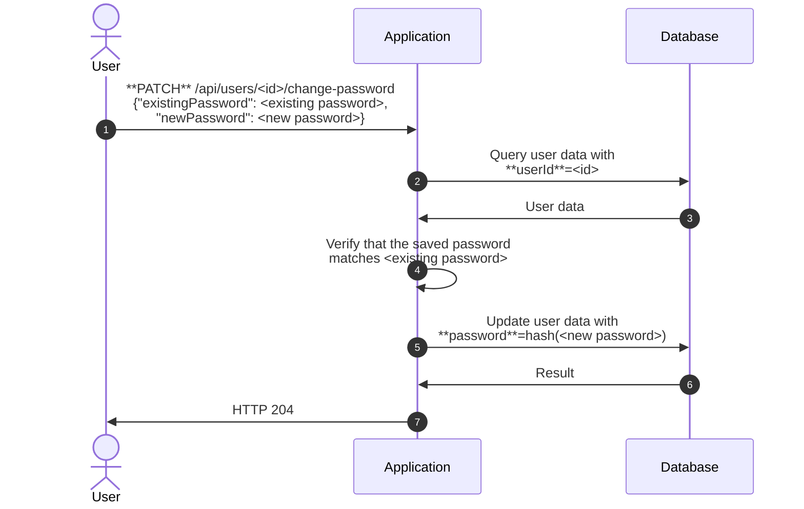
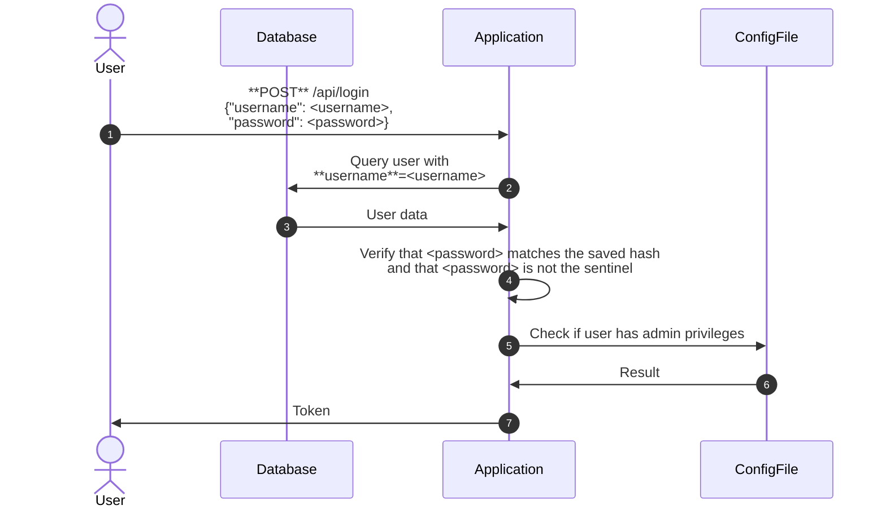
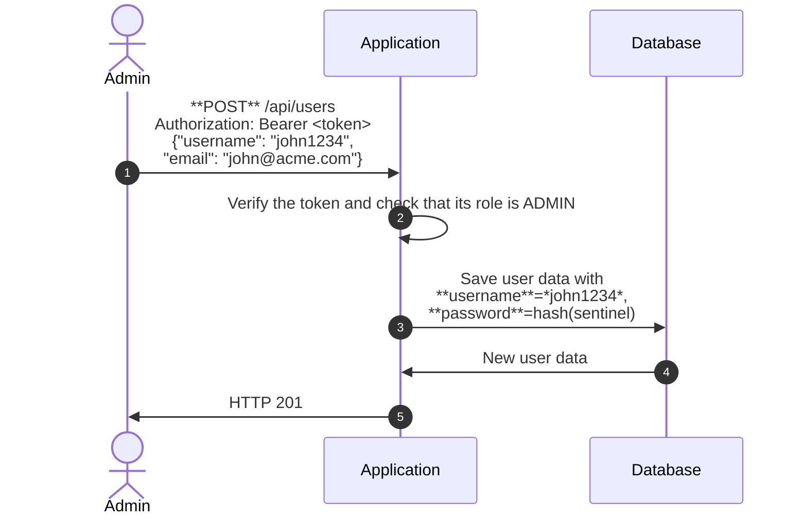

# starzz-laravel


This project is a production-style REST API built with Laravel, designed to demonstrate clean backend architecture and real-world API design patterns.

The API manages a database of fictional galaxies, constellations, and stars.

Mermaid diagrams illustrate request flows, allowing readers to quickly grasp the architecture while chapter walkthroughs provide deeper insight.

## Features

- REST API built with Laravel
- MySQL database interaction via Eloquent
- Data handling with Form Requests and API Resources
- Global exception handling
- Unit testing using Pest
- Integration testing using Pest against a dedicated MySQL test database
- BCrypt password hashing
- JWT-based authentication
- Role-based access control (ADMIN and USER roles)
- Postman collection included
- Architecture diagrams using Mermaid

## The Dataset

Here is a diagram to describe the tables and their relationships:


Stars are located in constellations, which are in turn located in galaxies.

The `galaxies`, `constellations` and `stars` tables contain the additional
fields `added_by` and `verified_by` to indicate the id of the users who made
the finding and verified it, respectively.

The database was created in MySQL.  The scripts to create the tables and
load the dummy data are included in `assets` for reference.

Our assumption is that we are working with a legacy database that cannot easily be altered.

## The Application

This project was created in Visual Studio Code.  It uses PHP, Composer, Laravel and MySQL.

First we enable several PHP extensions.  These will be needed to build our Laravel application.
In `php.ini`, enable:

    extension=curl
    extension=fileinfo
    extension=intl
    extension=mbstring
    extension=openssl
    extension=pdo_mysql

We then create our project:

```bash
composer global require laravel/installer
laravel new starzz-laravel
```

All code committed at each chapter is available with the commit message of the chapter name.

### Chapter 1: Setting up the routes

#### Overview

This chapter sets up the foundation of the Laravel application and demonstrates the basic routing and controller structure. It shows how requests flow from the routers to the controllers and how endpoints are defined using the MVC pattern. Hardcoded responses are used to verify routing, providing a clear view of how controllers handle HTTP requests. By the end, the project has a working skeleton API that illustrates the architecture and request flow.



#### Endpoints

|     Endpoint                | Method | Description                                              | Response |
|-----------------------------|--------|----------------------------------------------------------|----------|
| `/api/constellations`       | GET    | Returns *Successfully called getConstellationList()*     | 200 OK   |
| `/api/constellations/{id}`  | GET    | Returns *Successfully called getConstellation(id)*       | 200 OK   |
| `/api/constellations`       | POST   | Returns *Successfully called registerConstellation()*    | 200 OK   |
| `/api/constellations/{id}`  | PUT    | Returns *Successfully called updateConstellation(id)*    | 200 OK   |
| `/api/constellations/{id}`  | DELETE | Returns *Successfully called deleteConstellation(id)*    | 200 OK   |
| `/api/galaxies`             | GET    | Returns *Successfully called getGalaxyList()*            | 200 OK   |
| `/api/galaxies/{id}`        | GET    | Returns *Successfully called getGalaxy(id)*              | 200 OK   |
| `/api/galaxies`             | POST   | Returns *Successfully called registerGalaxy()*           | 200 OK   |
| `/api/galaxies/{id}`        | PUT    | Returns *Successfully called updateGalaxy(id)*           | 200 OK   |
| `/api/galaxies/{id}`        | DELETE | Returns *Successfully called deleteGalaxy(id)*           | 200 OK   |
| `/api/stars`                | GET    | Returns *Successfully called getStarList()*              | 200 OK   |
| `/api/stars/{id}`           | GET    | Returns *Successfully called getStar(id)*                | 200 OK   |
| `/api/stars`                | POST   | Returns *Successfully called registerStar()*             | 200 OK   |
| `/api/stars/{id}`           | PUT    | Returns *Successfully called updateStar(id)*             | 200 OK   |
| `/api/stars/{id}`           | DELETE | Returns *Successfully called deleteStar(id)*             | 200 OK   |
| `/api/users`                | GET    | Returns *Successfully called getUserList()*              | 200 OK   |
| `/api/users/{id}`           | GET    | Returns *Successfully called getUser(id)*                | 200 OK   |
| `/api/users`                | POST   | Returns *Successfully called registerUser()*             | 200 OK   |
| `/api/users/{id}`           | PUT    | Returns *Successfully called updateUser(id)*             | 200 OK   |

*A Postman collection for all routes is included in* `assets/starzz-laravel.postman_collection.json`

#### Sample Responses

GET /api/constellations
```json
{
    "text": "Successfully called getConstellationList()"
}
```

GET /api/constellations/100

```json
{
    "text": "Successfully called getConstellation(100)"
}
```

GET /api/galaxies

```json
{
    "text": "Successfully called getGalaxyList()"
}
```

GET /api/galaxies/100

```json
{
    "text": "Successfully called getGalaxy(100)"
}
```

GET /api/stars

```json
{
    "text": "Successfully called getStarList()"
}
```

GET /api/stars/100

```json
{
    "text": "Successfully called getStar(100)"
}
```

GET /api/users

```json
{
    "text": "Successfully called getUserList()"
}
```

GET /api/users/100

```json
{
    "text": "Successfully called getUser(100)"
}
```

<details>

<summary>Chapter Walkthrough</summary>


Laravel supports the MVC (Model-View-Controller) pattern. In our application, routes map incoming HTTP requests to the controller methods responsible for handling them.

By default, Laravel configures web routing through `routes/web.php`. For example, the default welcome route returns an HTML view. However, Laravel controllers are not limited to returning views; they can also return JSON responses.

In `bootstrap/app.php`:

```php
...
->withRouting(
    web: __DIR__.'/../routes/web.php',
    commands: __DIR__.'/../routes/console.php',
    health: '/up',
)
...
```

The `web` parameter registers the application's web routes. Requests matching those routes are dispatched to the corresponding route handlers.

Since we want to build a REST API instead of relying only on web routes, we register `routes/api.php` by adding:

```php
api: __DIR__.'/../routes/api.php',
```

Laravel automatically applies the `/api` prefix to routes defined in this file. Therefore, a route defined with the path `/constellations` is accessible under `/api/constellations`.

Our application manages several resources. Instead of placing all route definitions in one file, we organize them into separate files, one per resource. The main `routes/api.php` file includes these files:

```php
...
require __DIR__.'/api/constellation.php';
require __DIR__.'/api/galaxy.php';
require __DIR__.'/api/star.php';
require __DIR__.'/api/user.php';
```

For example, `routes/api/constellation.php` defines the routes for constellation-related requests:

```php
...
Route::prefix('constellations')->group(function () {
    Route::get('/', [ConstellationController::class, 'getConstellationList']);
    Route::get('/{id}', [ConstellationController::class, 'getConstellation']);
...
```

The `Route::prefix('constellations')` group applies the `constellations` prefix to the routes inside it. Combined with Laravel's automatic `/api` prefix, these routes expose the following endpoints:

- `GET /api/constellations/` invokes `ConstellationController::getConstellationList`.
- `GET /api/constellations/{id}` invokes `ConstellationController::getConstellation`, where `{id}` is a route parameter.

In `app/Http/Controllers/ConstellationController.php`:

```php
...
class ConstellationController extends Controller
{
    public function getConstellationList(): array
    {
        return ["message" => "Successfully called getConstellationList()"];
    }

    public function getConstellation(string $id): array
    {
        return ["message" => "Successfully called getConstellation({$id})"];
    }
...
```

This controller defines the methods that handle the two constellation routes. For now, each method returns a simple array containing a message. Laravel automatically serializes the returned array into a JSON response, allowing us to verify that the routing and controller dispatch work correctly.

The other resource route files and controllers follow a similar pattern.

In the next chapter, we introduce the persistence layer using Eloquent and connect our application to a MySQL database.

</details>

### Chapter 2: Setting up the database

#### Overview

This chapter introduces the persistence layer and connects the application to a MySQL database.  Models and relationships are defined.  Validation, exception handling, and structured response patterns are also included, making the API fully functional with proper separation of concerns.

##### HTTP GET



##### HTTP POST/PUT



##### HTTP DELETE



#### Updated Endpoints

|     Endpoint                | Method | Description                                              | Response       |
|-----------------------------|--------|----------------------------------------------------------|----------------|
| `/api/constellations`       | GET    | Returns the list of constellations                       | 200 OK         |
| `/api/constellations/{id}`  | GET    | Returns the constellation with the ID of *id*            | 200 OK         |
| `/api/constellations`       | POST   | Creates a new constellation record                       | 201 Created    |
| `/api/constellations/{id}`  | PUT    | Updates the constellation with the ID of *id*            | 200 OK         |
| `/api/constellations/{id}`  | DELETE | Deletes the constellation with the ID of *id*            | 204 No Content |
| `/api/galaxies`             | GET    | Returns the list of galaxies                             | 200 OK         |
| `/api/galaxies/{id}`        | GET    | Returns the galaxy with the ID of *id*                   | 200 OK         |
| `/api/galaxies`             | POST   | Creates a new galaxy record                              | 201 Created    |
| `/api/galaxies/{id}`        | PUT    | Updates the galaxy with the ID of *id*                   | 200 OK         |
| `/api/galaxies/{id}`        | DELETE | Deletes the galaxy with the ID of *id*                   | 204 No Content |
| `/api/stars`                | GET    | Returns the list of stars                                | 200 OK         |
| `/api/stars/{id}`           | GET    | Returns the star with the ID of *id*                     | 200 OK         |
| `/api/stars`                | POST   | Creates a new star record                                | 201 Created    |
| `/api/stars/{id}`           | PUT    | Updates the star with the ID of *id*                     | 200 OK         |
| `/api/stars/{id}`           | DELETE | Deletes the star with the ID of *id*                     | 204 No Content |
| `/api/users`                | GET    | Returns the list of users                                | 200 OK         |
| `/api/users/{id}`           | GET    | Returns the user with the ID of *id*                     | 200 OK         |
| `/api/users`                | POST   | Creates a new user record                                | 201 Created    |
| `/api/users/{id}`           | PUT    | Updates the user with the ID of *id*                     | 200 OK         |

*The Postman collection in* `assets/starzz-laravel.postman_collection.json` *has been updated to the
format of requests used in this chapter.*

*A Note on Deletion* - The application provides *DELETE* endpoints and implements cascade delete for constellations (i.e. deleting a parent constellation also deletes its children stars) and galaxies (i.e. deleting a parent galaxy also deletes its children constellations and their children stars), but **does not** provide a *DELETE* endpoint for users.  This is a deliberate design decision:

- Users are referenced by galaxies, constellations, and stars (`addedBy` and `verifiedBy`).
- Cascading delete through these relationships would risk data loss and long transactional operations.
- The existing database schema cannot be modified to add a soft-delete flag (`isActive`), so soft deletion is not possible.
- Therefore, user deletion is intentionally disabled to preserve historical data integrity.

#### Sample Responses

GET /api/constellations

```json
[
    {
        "constellationId": 1,
        "constellationName": "Pleiades"
    },
    {
        "constellationId": 2,
        "constellationName": "Orion"
    }
]
```

GET /api/constellations/100

```json
{
    "constellationId": 100,
    "constellationName": "Cassiopeia",
    "galaxy": {
        "galaxyId": 1,
        "galaxyName": "Andromeda"
    },
    "addedBy": {
        "userId": 10,
        "username": "mike14288"
    },
    "verifiedBy": {
        "userId": 37,
        "username": "centwhistle45939"
    }
}
```

GET /api/galaxies

```json
[
    {
        "galaxyId": 1,
        "galaxyName": "Andromeda"
    },
    {
        "galaxyId": 2,
        "galaxyName": "Poseidon"
    }
]
```

GET /api/galaxies/100

```json
{
    "galaxyId": 100,
    "galaxyName": "Valhalla",
    "galaxyType": "Barred Spiral",
    "distanceMly": 5096,
    "redshift": 4,
    "massSolar": 5434403,
    "diameterLy": 647254,
    "addedBy": {
        "userId": 15,
        "username": "rtavener27922"
    },
    "verifiedBy": {
        "userId": 62,
        "username": "kchatres44202"
    }
}
```

GET /api/stars

```json
[
    {
        "starId": 1,
        "starName": "Sol"
    },
    {
        "starId": 2,
        "starName": "Rigel"
    }
]
```

GET /api/stars/100

```json
{
    "starId": 100,
    "starName": "Centaur",
    "starType": "red dwarf star",
    "constellation": {
        "constellationId": 38,
        "constellationName": "Cans Minor"
    },
    "rightAscension": 10,
    "declination": 78,
    "apparentMagnitude": -12,
    "spectralType": "O",
    "addedBy": {
        "userId": 1,
        "username": "ebalducci29128"
    },
    "verifiedBy": {
        "userId": 89,
        "username": "ogarriock20720"
    }
}
```

GET /api/users

```json
[
    {
        "userId": 1,
        "username": "ebalducci29128"
    },
    {
        "userId": 2,
        "username": "ldilloway50275"
    }
]
```

GET /api/users/100

```json
{
    "userId": 100,
    "username": "tperazzo50392",
    "email": "torey.perazzo@yahoo.com",
    "firstName": "Torey",
    "lastName": "Perazzo",
    "dateOfBirth": "1998-05-26"
}
```

<details>

<summary>Chapter Walkthrough</summary>

To persist and retrieve data, we now introduce a persistence layer. In Laravel applications,
this is typically achieved using Eloquent on top of a relational database.  In our case,
it is our **starzz** database on MySQL.

To allow our application to interact with the database, we would first need to configure our
database connection.  `config/database.php` has an associative array to define multiple connections; for MySQL, it is:

```php
...
'mysql' => [
    'driver' => 'mysql',
    'url' => env('DB_URL'),
    'host' => env('DB_HOST', '127.0.0.1'),
    'port' => env('DB_PORT', '3306'),
    'database' => env('DB_DATABASE', 'laravel'),
    'username' => env('DB_USERNAME', 'root'),
    'password' => env('DB_PASSWORD', ''),
...
```

It refers to several environment variables; we define these variables in our `.env` file:

    DB_CONNECTION=mysql
    DB_HOST=127.0.0.1
    DB_PORT=3306
    DB_DATABASE=starzz
    DB_USERNAME=<your database's username>
    DB_PASSWORD=<your database's password>

We now create our code to interact with our database.

Eloquent allows us to work with database tables in an object-oriented way.  We add classes to abstract tables, and we define their relationships with other tables.  In `app/Models`, we create these classes.  An example class is `Constellation`:

```php
...
class Constellation extends Model
{
    protected $table = 'constellations';

    protected $primaryKey = 'constellation_id';

    protected $fillable = ['constellation_name', 'galaxy_id', 'added_by', 'verified_by',];

    public $timestamps = false;

    public function galaxy(): BelongsTo
    {
        return $this->belongsTo(Galaxy::class, 'galaxy_id', 'galaxy_id');
    }

    public function addedBy(): BelongsTo
    {
        return $this->belongsTo(User::class, 'added_by', 'user_id');
    }

    public function verifiedBy(): BelongsTo
    {
        return $this->belongsTo(User::class, 'verified_by', 'user_id');
    }
    
    public function stars(): HasMany
    {
        return $this->hasMany(Star::class, 'constellation_id', 'constellation_id');
    }
}
```

`$table` and `$primaryKey` correspond to the table's name and primary key, respectively.  `$fillable` lists the columns allowed for mass assignment through *create* and *update*.  `$timestamps` is set to `false` to indicate that the table has no fields for Laravel timestamps.  `galaxy()`, `addedBy()`, `verifiedBy()` and `stars()` are functions that define the table's relationships with other tables.

Whenever we send data as part of responses, we usually don't send raw models from our database.
We create mappings from our models to custom objects, and send those objects instead.  These
custom objects are known as data transfer objects.  In Laravel, we refer to them as *API Resources*.

API Resources are returned to the user as JSON documents wrapped inside a `data` element:

```json
{
    "data": {
        <key>: <value>
    }
}
```

We can remove the `data` wrapper to only have:

```json
{
    <key>: <value>
}
```

In `app/Providers/AppServiceProvider.php` we modify `boot()` to:

```php
public function boot(): void
{
    JsonResource::withoutWrapping();
}
```

We now create a folder `app/Http/Resources` to contain our API Resource classes.  An example class is `ConstellationSummaryResource`:

```php
...
class ConstellationSummaryResource extends JsonResource
{
    public function toArray(Request $request): array
    {
        return [
            'constellationId' => $this->constellation_id,
            'constellationName' => $this->constellation_name,
        ];
    }
}
```

It defines `toArray()` that returns an associative array based on properties of the underlying model.

Another example is `ConstellationDetailResource`:

```php
class ConstellationDetailResource extends JsonResource
{
    public function toArray(Request $request): array
    {
        return [
            'constellationId' => $this->constellation_id,
            'constellationName' => $this->constellation_name,
            'galaxy' => new GalaxySummaryResource($this->galaxy),
            'addedBy' => new UserSummaryResource($this->addedBy),
            'verifiedBy' => new UserSummaryResource($this->verifiedBy),
        ];
    }
}
```

This class is similar to `ConstellationSummaryResource`; the returned associative array has additional fields to display the parent galaxy, and the adder and verifier.  These fields are themselves API Resources, and are created using the underlying model's relationships.

We also have a custom object to accept JSON input when processing requests to add or update constellation.  In Laravel, we refer to it as a *Form Request*.  Form Requests validate incoming data before the controller runs.  Controllers then call `validated()` that returns only the fields that passed.

We now create a folder `app/Http/Requests` to contain our Form Request classes.  An example class is `StoreConstellationRequest`:

```php
...
class StoreConstellationRequest extends FormRequest
{
    public function authorize(): bool
    {
        return true;
    }

    public function rules(): array
    {
        return [
            'constellationName' => ['required', 'string', 'max:100'],
            'galaxyId' => ['required', 'integer', 'exists:galaxies,galaxy_id'],
            'adderId' => ['required', 'integer', 'exists:users,user_id'],
            'verifierId' => ['nullable', 'integer', 'exists:users,user_id'],
        ];
    }
}
```

`rules()` returns an array specifying validation rules on the fields.  `authorize()` determines whether the currently authenticated user is permitted to perform the requested action before validation runs.  We set it to always return `true` for now because we have no special authorization logic.

The other classes in the `app/Models`, `app/Http/Resources` and `app/Http/Requests` folders follow a similar logic.

Whenever our application processes requests, errors may occur, e.g. a request for a nonexistent
constellation.  Laravel throws exceptions to convey information about these events.  We do this with exception handling.  We may want to customize Laravel's default exception handling.  In `bootstrap/app.php`:

```php
...
    ->withExceptions(function (Exceptions $exceptions): void {
        $exceptions->render(function (NotFoundHttpException $exception, Request $request) {
            if ($request->is('api/*')) {
                return response()->json([
                    'message' => 'Not found.',
                ], 404);
            }
        });
        $exceptions->render(function (ValidationException $exception, Request $request) {
            if ($request->is('api/*')) {
                return response()->json([
                    'message' => $exception->getMessage(),
                    'errors' => $exception->errors(),
                ], 400);
            }
        });
        $exceptions->shouldRenderJsonWhen(function (Request $request, Throwable $e) {
            return $request->is('api/*') || $request->expectsJson();
        });
    })
...
```

When Laravel throws `NotFoundHttpException`, our application responds with HTTP 404 and a message similar to "not found".  When Laravel throws `ValidationException`, our application responds with HTTP 400 and a message listing the validation errors.  Any other exception returns HTTP 500 as JSON. The response includes the stack trace only when `APP_DEBUG=true`.

Another validation we can add is numeric `id` validation on endpoints that require ids.  For example, when our application receives **GET** `/api/constellations/xyz`, a constellation with an id of `xyz` is guaranteed to be nonexistent.  To save a database query, we can put the validation in the route definition so Laravel immediately throws `NotFoundHttpException` on non-numeric id.

We define the route groupings in `routes/api.php` (we define the route prefixes here, instead of in the route files):

```php
...
Route::prefix('constellations')->group(__DIR__ . '/api/constellation.php');
Route::prefix('galaxies')->group(__DIR__ . '/api/galaxy.php');
Route::prefix('stars')->group(__DIR__ . '/api/star.php');
Route::prefix('users')->group(__DIR__ . '/api/user.php');
```

Routes defined in `routes/api/constellation.php` have the prefix `/constellations`, and so on.

And in `routes/api/constellation.php`:

```php
...
Route::get('/', [ConstellationController::class, 'getConstellationList']);
Route::post('/', [ConstellationController::class, 'registerConstellation']);

Route::where(['id' => '[0-9]+'])->group(function () {
    Route::get('/{id}', [ConstellationController::class, 'getConstellation']);
    Route::put('/{id}', [ConstellationController::class, 'updateConstellation']);
    Route::delete('/{id}', [ConstellationController::class, 'deleteConstellation']);
});
```

Note that the last 3 routes belong to a group that requires `id` to conform to the regular expression `[0-9]+`.

Finally, we rewrite our `ConstellationController.php`:

```php
...
class ConstellationController extends Controller
{
    public function getConstellationList(): AnonymousResourceCollection
    {
        return ConstellationSummaryResource::collection(
            Constellation::all()
        );
    }

    public function getConstellation(int $id): ConstellationDetailResource
    {
        return new ConstellationDetailResource(
            Constellation::with(['galaxy', 'addedBy', 'verifiedBy'])
                ->findOrFail($id)
        );
    }

    public function registerConstellation(StoreConstellationRequest $request): JsonResponse
    {
        $data = $request->validated();

        $constellation = Constellation::create([
            'constellation_name' => $data['constellationName'],
            'galaxy_id' => $data['galaxyId'],
            'added_by' => $data['adderId'],
            'verified_by' => $data['verifierId'] ?? null,
        ]);

        return $this->getConstellation($constellation->constellation_id)
            ->response()
            ->setStatusCode(201);
    }
...
```

We now return our API Resources.  Where appropriate, we require our Form Requests and integer id for function parameters.

The other classes in the `app/Http/Controllers` folder follow a similar logic.

Now that we’ve finished setting up the database, our app is starting to grow.  With more pieces working together, it’s easy to accidentally break something when we add new features. That’s why it’s a good idea to start writing **unit tests** now — they help us make sure each part works on its own and keep everything running smoothly as the project grows.

</details>

### Chapter 3: Setting up unit tests

#### Overview

This chapter introduces unit testing using Pest.  Our controllers call Eloquent directly and there is no service layer, so there is nothing to isolate with mocks.  Instead, we test the pieces that can run without a database.  API Resources are tested with models built in memory, Form Request rules are tested directly against Laravel's validator, and the routing and exception handling are tested with requests that are rejected before any query runs.  The controllers themselves are not tested yet since they need a real database.



<details>

<summary>Chapter Walkthrough</summary>

To test our application, we will use **Pest**.  Pest is a testing framework built on top of PHPUnit with a simpler, more readable syntax.  It was installed when we created the project, so we don't need to add anything to `composer.json`.

Our tests will be written in the `tests` folder, which was also added upon project creation.  It has two subfolders, `tests/Feature` and `tests/Unit`.  Laravel generated an example test in each; we delete both.

Our unit tests go in `tests/Unit`.  The testing class' name is the name of the thing being tested, with the suffix `Test`; Pest only picks up files that end this way.  For each resource we write three files, e.g. for constellations:

    tests/Unit/ConstellationResourcesTest.php
    tests/Unit/ConstellationRequestTest.php
    tests/Unit/ConstellationRoutesTest.php

We first configure Pest.  In `tests/Pest.php`:

```php
pest()->extend(Tests\TestCase::class)->in('Feature', 'Unit');
```

`Tests\TestCase` is Laravel's base test class.  It boots the application before each test, which gives our tests access to things like `config()`, Laravel's validator and the HTTP kernel.  By default, Pest only extends it for `tests/Feature`; since our unit tests need these too, we add `Unit`.

In the same file, we define two functions that all our tests share:

```php
function validateWithoutDb(FormRequest $request, array $data): Validator
{
    $rules = array_map(
        fn(array $fieldRules) => array_values(array_filter(
            $fieldRules,
            fn($rule) => ! (is_string($rule) && str_starts_with($rule, 'exists:'))
        )),
        $request->rules()
    );

    return validator($data, $rules);
}

function resourceToArray(mixed $resource): array
{
    return json_decode(json_encode($resource), true);
}
```

`validateWithoutDb()` takes a Form Request's rules, removes the `exists:` rules, and validates the supplied data against what remains.  The `exists:` rules check that a foreign key is present in another table, which needs a database, so we leave them out of the unit tests and cover them in the next chapter.  All the other rules, such as `required`, `integer`, `max` and `nullable`, are still applied.  `resourceToArray()` converts an API Resource to an array the same way Laravel does when it builds the response body.

Our tests also need sample data.  We put this in `tests/Helpers.php`, and load it from `tests/Pest.php`:

```php
require_once __DIR__ . '/Helpers.php';
```

The helpers come in two kinds.  The first kind builds request payloads, i.e. valid JSON bodies that tests can modify:

```php
function createGalaxyPayload(array $overrides = []): array
{
    return array_merge([
        'galaxyName' => 'Test Galaxy',
        'galaxyType' => 'Spiral',
        'distanceMly' => 1234,
        'redshift' => 6,
        'massSolar' => 89700,
        'diameterLy' => 45000,
        'adderId' => 1,
    ], $overrides);
}
```

A test starts from a valid payload and overrides only the field it cares about.  `array_merge()` lets the values in `$overrides` replace the defaults.

The second kind builds models in memory:

```php
function makeMinimalUser(int $id, string $name): User
{
    return (new User)->forceFill(['user_id' => $id, 'username' => $name]);
}

function makeGalaxy(): Galaxy
{
    $galaxy = (new Galaxy)->forceFill([
        'galaxy_id' => 5,
        'galaxy_name' => 'GAL-1',
        'galaxy_type' => 'Spiral',
        'distance_mly' => 100,
        'redshift' => 2,
        'mass_solar' => 300,
        'diameter_ly' => 400,
    ]);
    $galaxy->setRelation('addedBy', makeMinimalUser(10, 'adder'));
    $galaxy->setRelation('verifiedBy', makeMinimalUser(11, 'verifier'));
    return $galaxy;
}
```

Instead of loading models from the database, we build them in memory; nothing is saved.  `forceFill()` sets the model's attributes directly, bypassing `$fillable`.  `setRelation()` attaches a related model, standing in for what Eloquent would have loaded from the database.  Note that `setRelation()` takes the name of the relationship method, e.g. `addedBy`, and not the column name `added_by`; the name is what our API Resources read, as in `$this->addedBy`.

The "minimal" helpers, e.g. `makeMinimalUser()`, only fill in the id and name.  We use them for the related models, since our API Resources only output the summary (id and name) of related models.

We start with writing unit tests for our API Resources.  In `tests/Unit` we create `ConstellationResourcesTest.php`:

```php
it('displays a correct constellation summary', function () {
    expect(resourceToArray(new ConstellationSummaryResource(makeConstellation())))
        ->toBe([
            'constellationId' => 1,
            'constellationName' => 'C-882',
        ]);
});

it('maps a complete constellation record', function () {
    expect(resourceToArray(new ConstellationDetailResource(makeConstellation())))
        ->toBe([
            'constellationId' => 1,
            'constellationName' => 'C-882',
            'galaxy' => ['galaxyId' => 1, 'galaxyName' => 'Andromeda'],
            'addedBy' => ['userId' => 10, 'username' => 'adder'],
            'verifiedBy' => ['userId' => 11, 'username' => 'verifier'],
        ]);
});

it('returns null for a missing verifier', function () {
    $constellation = makeConstellation();
    $constellation->setRelation('verifiedBy', null);

    expect(resourceToArray(new ConstellationDetailResource($constellation)))
        ->toHaveKey('verifiedBy', null);
});
```

`it()` defines a test; its first argument is the description, and the second is the function containing the test.  `expect()` starts an assertion, and `toBe()` checks that the value is identical to the expected one, including the order of the keys.  `toHaveKey()` checks that a key exists with the given value.

All three tests are for the resources of a single model.  The third verifies that a missing verifier is serialized as `null` rather than breaking the response.  Since a verifier is optional in our schema, this case matters.

The test for the user resource has one more assertion:

```php
it('maps a complete user record', function () {
    $result = resourceToArray(new UserDetailResource(makeUser()));

    expect($result)
        ->not->toHaveKey('password')
        ->and($result)->toBe([
            'userId' => 1,
            'username' => 'john',
            'email' => 'john@example.com',
            'firstName' => 'John',
            'lastName' => 'Smith',
            'dateOfBirth' => '2000-02-28',
        ]);
});
```

`makeUser()` gives the user a password, and the test asserts that it never appears in the output.  `->not` negates the assertion that follows it, and `->and()` starts a second assertion on a new value.

The other classes in the `tests/Unit` folder named `*ResourcesTest` follow a similar logic.

We now write unit tests for our Form Requests.  In `tests/Unit` we create `GalaxyRequestTest.php`:

```php
it('rejects :dataset longer than 100 characters', function (string $field) {
    expect(validateWithoutDb(
        new StoreGalaxyRequest,
        createGalaxyPayload([$field => str_repeat('a', 101)])
    )
        ->errors()->has($field))->toBeTrue();
})->with(['galaxyName', 'galaxyType']);

it('requires :dataset', function (string $field) {
    $data = createGalaxyPayload();
    unset($data[$field]);

    expect(validateWithoutDb(
        new StoreGalaxyRequest,
        $data
    )
        ->errors()->has($field))->toBeTrue();
})->with(['galaxyName', 'galaxyType', 'distanceMly', 'redshift', 'massSolar', 'diameterLy', 'adderId']);

it('rejects values > 32-bit int max for :dataset', function (string $field) {
    expect(validateWithoutDb(
        new StoreGalaxyRequest,
        createGalaxyPayload([$field => config('starzz.int_max') + 1])
    )
        ->errors()->has($field))->toBeTrue();
})->with(['distanceMly', 'massSolar', 'diameterLy', 'redshift']);
```

`validateWithoutDb()` returns the validator.  `fails()` is `true` when validation failed, and `errors()->has($field)` is `true` when there is an error for that particular field.  So a test that expects a payload to be accepted asserts `fails()` is `false`, and a test that expects a payload to be rejected asserts that the offending field has an error.

`->with([...])` is a *dataset*.  Pest runs the test once for each value in the list, passing the value as the function's parameter.  The `:dataset` placeholder in the description is replaced by the value, so the first test above is reported as two separate tests, one each for `galaxyName` and `galaxyType`.  This lets us write one test for a rule and apply it to every field it covers.

The tests above use `str_repeat('a', 101)` to build a string one character longer than the allowed 100.  For every limit we write a pair of tests, one just inside it and one just outside it, e.g. 100 characters is accepted and 101 is rejected.  This verifies that the limit is exactly what we configured, and not off by one.  The same is done for the 32-bit integer limits, which are read from `config('starzz.int_min')` and `config('starzz.int_max')` instead of repeating the numbers.  This is why our unit tests need `Tests\TestCase`; `config()` only works once the application is booted.

Some tests pass a list of invalid values:

```php
it('rejects non-int values for verifier', function (mixed $value) {
    expect(validateWithoutDb(
        new StoreGalaxyRequest,
        createGalaxyPayload(['verifierId' => $value])
    )
        ->errors()->has('verifierId'))->toBeTrue();
})->with(['abc', 1.5]);
```

Both `'abc'` and `1.5` fail the `integer` rule.  Even though we skip `exists:`, this still verifies that `verifierId` must be an integer.

Not every field has the same limits.  `distanceMly`, `massSolar` and `diameterLy` cannot be negative, so we also have tests that `-1` is rejected and `0` is accepted for them.  `redshift` can be negative, so its tests accept the 32-bit minimum and reject anything below it.  `verifierId` is optional, so there are tests that a payload without it, and one with it set to `null`, are both accepted.

The other classes in the `tests/Unit` folder named `*RequestTest` follow a similar logic.  `StarRequestTest` also tests that `spectralType` accepts 5 characters and rejects 6.  `UserRequestTest` tests that `email` is a valid email and no longer than 100 characters; for the boundary we build an email of exactly 100 characters with `str_repeat('a', 94) . '@a.com'`.

We finish with unit tests for our routes.  In `tests/Unit` we create `ConstellationRoutesTest.php`:

```php
it('GET returns HTTP 404 for a non-numeric id', function () {
    $this->get('/api/constellations/xyz')
        ->assertStatus(404)
        ->assertExactJson(['message' => 'Not found.']);
});

it('POST returns HTTP 400 with errors when the body fails validation', function () {
    $this->post('/api/constellations', [])
        ->assertStatus(400)
        ->assertJsonValidationErrors(['constellationName', 'galaxyId', 'adderId']);
});

it('PUT returns HTTP 400 with errors when the body fails validation', function () {
    $this->put('/api/constellations/1', [])
        ->assertStatus(400)
        ->assertJsonValidationErrors(['constellationName', 'galaxyId', 'adderId']);
});
```

`$this->get()`, `$this->post()` and `$this->put()` send requests through the application.  The `assert...` methods check the response.  `assertExactJson()` checks that the body is exactly the given JSON, and `assertJsonValidationErrors()` checks that the response lists errors for the given fields.

These tests verify the decisions we made in `bootstrap/app.php` and in our route files.  The first sends a non-numeric id.  The route's `[0-9]+` constraint rejects it, Laravel throws `NotFoundHttpException`, and our handler responds with HTTP 404.  The other two send an empty body.  Validation fails and our handler responds with HTTP 400 instead of Laravel's default 422.

Why don't these tests need a database?  Form Request validation runs before the controller method does, so for the `PUT` test above, validation fails before `findOrFail()` ever executes.  And a request with a non-numeric id doesn't match any route, so it never reaches a controller at all.

The users have no DELETE endpoint, so `UserRoutesTest` has a test for that decision:

```php
it('DELETE is not allowed on a user', function () {
    $this->delete('/api/users/1')->assertStatus(405);
});
```

A numeric id is used so that the request matches the path but not the method.  Laravel then responds with HTTP 405 (Method Not Allowed).

The other classes in the `tests/Unit` folder named `*RoutesTest` follow a similar logic.

> **Note:** Strictly speaking, the route tests are feature tests because the requests pass through the whole HTTP layer.  We keep them with the unit tests since they never query the database.

We do not write unit tests for the controllers.  They call Eloquent directly, so testing them without a database would mean mocking Eloquent itself, which tells us very little.  We test them with a real database in the next chapter.

In the next chapter, we introduce integration tests. Unlike the unit tests in this chapter, integration tests send requests through the full application and interact with a database. This allows us to verify that all layers of the application work correctly together, including the `exists:` validation rules that we skipped here and the cascading deletes of galaxies and constellations.

</details>

### Chapter 4: Setting up integration tests

#### Overview

This chapter introduces integration tests.  Integration tests verify that all layers of the application work correctly together: routing, validation, controllers, Eloquent and the database.  Unlike the unit tests in the previous chapter, they send requests through the full application and interact with a real MySQL database.  To keep our development data safe, the tests use a dedicated test database, `starzz_test`, which has the same tables and the same data as `starzz`.



<details>

<summary>Chapter Walkthrough</summary>

We use integration tests to check that all the components that we have coded work together as expected.  Our unit tests skipped everything that needs a database: the `exists:` validation rules, the controllers, and the cascading deletes.  The integration tests cover them.

Our integration tests go in `tests/Feature`, which already exists.  Each controller has a dedicated test class, e.g. `ConstellationApiTest.php`.

We first need to point our tests to a different database.  By default, Laravel's `phpunit.xml` configures tests to use an in-memory SQLite database.  Our tests need MySQL, so in `phpunit.xml` we replace:

```xml
<env name="DB_CONNECTION" value="sqlite"/>
<env name="DB_DATABASE" value=":memory:"/>
```

with:

```xml
<env name="DB_CONNECTION" value="mysql"/>
<env name="DB_DATABASE" value="starzz_test"/>
```

The `<env>` entries in `phpunit.xml` are applied when the tests start.  This means that no matter what `.env` says, our tests run against `starzz_test`.  The host, port and credentials are still read from `.env`.

The test database was created beforehand, using the same scripts in `assets` that created our `starzz` database.  This way our tests run against the same schema and the same seed data (100 records per table) as the application.

Since a misconfiguration here would run our tests against the real data, we add a safeguard.  In `tests/TestCase.php`:

```php
abstract class TestCase extends BaseTestCase
{
    protected function setUp(): void
    {
        $database = (string) ($_ENV['DB_DATABASE'] ?? getenv('DB_DATABASE'));

        if (! str_ends_with($database, '_test')) {
            throw new RuntimeException(
                "Refusing to run tests: DB_DATABASE is '{$database}', but it must end in '_test'."
            );
        }

        parent::setUp();
    }
}
```

`setUp()` runs before every test.  It checks the name of the configured database, and throws an exception if the name does not end in `_test`.  Note that the check runs before `parent::setUp()`, which boots the application, so nothing connects to the database when the name is wrong.

Tests that modify data (*POST, PUT, DELETE*) might affect other tests.  To avoid this, we wrap each of them in a database transaction that is rolled back after the test.  In `tests/Pest.php`:

```php
pest()->extend(Tests\TestCase::class)->in('Unit');
pest()->extend(Tests\TestCase::class)->use(DatabaseTransactions::class)->in('Feature');
```

`DatabaseTransactions` is a trait provided by Laravel.  It starts a transaction before each test and rolls it back afterwards, so whatever the test inserted, updated or deleted is undone and the seed data stays intact.  We apply it only to `tests/Feature`; the unit tests never touch the database.

Some tests, like the deletion tests, need records that are guaranteed to have specific children.  Instead of depending on the seed data, they create their own records.  We add these helpers to `tests/Helpers.php`:

```php
function insertConstellation(int $galaxyId, string $name = 'Test Constellation'): Constellation
{
    return Constellation::create([
        'constellation_name' => $name,
        'galaxy_id' => $galaxyId,
        'added_by' => 1,
    ]);
}

function insertStar(int $constellationId, string $name = 'Test Star'): Star
{
    return Star::create([
        'star_name' => $name,
        'star_type' => 'red dwarf star',
        'constellation_id' => $constellationId,
        'right_ascension' => 1,
        'declination' => 1,
        'apparent_magnitude' => 1,
        'spectral_type' => 'O',
        'added_by' => 1,
    ]);
}
```

`insertGalaxy()` is similar.  These helpers save real records to the database, and the transaction undoes them when the test ends.

We now create our integration tests.  In `tests/Feature` we create `ConstellationApiTest.php`:

```php
it('GET returns a constellation with its galaxy, adder and verifier', function () {
    $this->getJson('/api/constellations/1')
        ->assertOk()
        ->assertJson([
            'constellationId' => 1,
            'constellationName' => 'CON-YKkuk',
            'galaxy' => ['galaxyId' => 1],
            'addedBy' => ['userId' => 10],
            'verifiedBy' => ['userId' => 37],
        ]);
});

it('GET returns HTTP 404 for a nonexistent id', function () {
    $this->getJson('/api/constellations/9999')
        ->assertNotFound()
        ->assertExactJson(['message' => 'Not found.']);
});
```

`getJson()` sends a request to the application with the `Accept: application/json` header already set.  `assertOk()` and `assertNotFound()` check for HTTP 200 and 404, respectively.  `assertJson()` checks that the response contains the given data; unlike `assertExactJson()`, it ignores any other fields in the response, so we only need to list the fields we care about.

The values in the first test come from the seed data; constellation 1 is `CON-YKkuk` in galaxy 1, added by user 10 and verified by user 37.

```php
it('POST creates a constellation and returns HTTP 201', function () {
    $this->postJson('/api/constellations', createConstellationPayload(['constellationName' => 'Brand New']))
        ->assertCreated()
        ->assertJson(['constellationName' => 'Brand New', 'galaxy' => ['galaxyId' => 1]]);

    $this->assertDatabaseHas('constellations', [
        'constellation_name' => 'Brand New',
        'galaxy_id' => 1,
        'added_by' => 1,
        'verified_by' => null,
    ]);
});
```

We reuse `createConstellationPayload()` from the previous chapter to build the request body.  After checking the response, `assertDatabaseHas()` queries the database directly to confirm that the record was really saved with the expected values.  This is something our unit tests could not verify.

Now that we have a database, we can also test the `exists:` rules that we skipped in the previous chapter:

```php
it('POST returns HTTP 400 when a referenced id does not exist', function (string $field, int $value) {
    $this->postJson('/api/constellations', createConstellationPayload([$field => $value]))
        ->assertStatus(400)
        ->assertJsonValidationErrors($field);
})->with([
    'galaxyId' => ['galaxyId', 9999],
    'adderId' => ['adderId', -1],
    'verifierId' => ['verifierId', 9999],
]);
```

This is a dataset like those in the previous chapter, but each entry now has a key and two values.  Pest runs the test once per entry, using the key as part of the test's name and passing the values as the function's parameters.  Each run sends a valid payload with one reference replaced by an id that does not exist in the database, and expects HTTP 400 with an error on that field.

For updates, we create a record of our own and modify it:

```php
it('PUT updates a constellation and returns HTTP 200', function () {
    $constellation = insertConstellation(1, 'Before');
    $id = $constellation->constellation_id;

    $this->putJson("/api/constellations/{$id}", createConstellationPayload([
        'constellationName' => 'After',
        'galaxyId' => 2,
    ]))
        ->assertOk()
        ->assertJson(['constellationId' => $id, 'constellationName' => 'After', 'galaxy' => ['galaxyId' => 2]]);

    $this->assertDatabaseHas('constellations', [
        'constellation_id' => $id,
        'constellation_name' => 'After',
        'galaxy_id' => 2,
    ]);
});
```

There is also a test that a *PUT* without a `verifierId` sets the record's verifier back to `null`, since an update replaces all the fields of the record.

Finally, we test deletion.  Our database has foreign keys but no `ON DELETE CASCADE`, and we cannot alter the schema, so the controllers delete the children themselves.  Deleting a constellation also deletes its stars.  Deleting a galaxy deletes its constellations and their stars.  These tests verify that, and also that nothing else is deleted:

```php
it('DELETE removes a constellation and its stars, and nothing else', function () {
    $constellation = insertConstellation(1);
    insertStar($constellation->constellation_id, 'Star A');
    insertStar($constellation->constellation_id, 'Star B');

    $other = insertConstellation(1, 'Other');
    $otherStar = insertStar($other->constellation_id, 'Other Star');

    $this->deleteJson("/api/constellations/{$constellation->constellation_id}")
        ->assertNoContent();

    $this->assertDatabaseMissing('constellations', ['constellation_id' => $constellation->constellation_id]);
    $this->assertDatabaseMissing('stars', ['constellation_id' => $constellation->constellation_id]);
    $this->assertDatabaseHas('constellations', ['constellation_id' => $other->constellation_id]);
    $this->assertDatabaseHas('stars', ['star_id' => $otherStar->star_id]);
});
```

The test creates a constellation with two stars, and a second constellation with one star.  After deleting the first constellation, `assertDatabaseMissing()` confirms that it and its stars are gone, and `assertDatabaseHas()` confirms that the second constellation and its star are untouched.  The test for galaxies follows the same idea, one level deeper.

The other classes in the `tests/Feature` folder follow a similar logic.  A few tests are specific to certain resources:

- Users never expose their `password`; `assertJsonMissingPath('password')` verifies this for both *GET* and *POST* responses.
- When a user is registered, the saved password is the password reset sentinel from our configuration.  For now it is saved as-is; we will revisit this in the next chapter.
- Updating a user does not change the user's password.

In the next chapter, we take our first step to secure our application.  Until now, anyone who knows the URL of an endpoint can call it freely, and passwords are saved as plain text.  We introduce password hashing in preparation for authentication, which ensures that only authorized users can make changes to our data.

</details>

### Chapter 5: Setting up password hashing

#### Overview

In this chapter, we introduce password hashing.  Passwords are now saved as hashes instead of plain text.  When a user is registered, the default password is hashed before it is saved to the database.  To do this, we change our `User` model to extend Laravel's `Authenticatable` class and tell it to hash the `password` attribute whenever it is set.  A new endpoint, `PATCH /api/users/{id}/change-password`, allows users to update their password by supplying their existing password and a new one.  The same endpoint handles both the initial password reset (where the existing password is the sentinel) and a regular password change.

#### User Registration



#### User Changes Password



#### New Endpoint

| Endpoint                          | Method | Description                  | Response       |
|-----------------------------------|--------|------------------------------|----------------|
| `/api/users/{id}/change-password` | PATCH  | Updates the user's password  | 204 No Content |

*The Postman collection in* `assets/starzz-laravel.postman_collection.json` *has been updated to include this new endpoint.*

<details>

<summary>Chapter Walkthrough</summary>

Whenever users are registered to our application, they are assigned a default password.  This default is a reminder that a user has to change his password before he can fully use our application; we will henceforth be referring to this value as the *sentinel*.  We keep it in a configuration file so that it is defined in one place.  In `config/starzz.php`:

```php
return [
    'password_reset_sentinel' => env('STARZZ_PASSWORD_RESET_SENTINEL'),
    // ...
];
```

Our code reads it with `config('starzz.password_reset_sentinel')`.  We use `config()` instead of calling `env()` directly because `env()` is only reliable inside the files in `config/`.

Up until now, our application saved the sentinel to the database as-is.  We did this deliberately in Chapter 2, so that we could confirm that writing to the database actually works.  This is not secure.  Anyone with access to the database can see every user's password.  To prevent this, we need some way to save passwords in a form that cannot be reversed.

This is where hashing comes in.  A hash is the result of passing some input through a hash function.  A hash function is a one-way function i.e. given the result of the function, we cannot figure out what the input to the function was.  This can be used for passwords.

This is how hashing will help us.  Any password that is to be saved to the database is first passed to a hash function.  The hash, not the actual password, is the user's password saved to the database.  Even if someone manages to read this value, there is no way to derive the original password from it.

Laravel uses the BCrypt algorithm by default.  BCrypt is a salted hash function, meaning the same input produces a different hash each time.  A password's hashes taken at different times will be different.  So to check a password later on, we cannot simply hash the supplied password and compare it to the saved hash.  Instead, we use `Hash::check()`, which extracts the salt from the saved hash and uses it to verify the supplied password.

Laravel provides everything we need, so there is nothing to add to `composer.json`.

Now we modify our model.  In `app/Models/User.php`:

```php
use Illuminate\Foundation\Auth\User as Authenticatable;

class User extends Authenticatable
{
    protected $table = 'users';

    protected $primaryKey = 'user_id';

    protected $fillable = [
        'username',
        'password',
        'email',
        'first_name',
        'last_name',
        'date_of_birth',
    ];

    public $timestamps = false;

    protected function casts(): array
    {
        return ['password' => 'hashed'];
    }
}
```

There are two changes.  First, `User` now extends `Authenticatable` instead of `Model`.  `Authenticatable` is Laravel's base class for models that represent users who log in.  It is still an Eloquent model, so everything we had before continues to work.  We will need it when we add authentication, so we make the change now.

Second, we add `casts()`.  A cast tells Eloquent to convert an attribute to a particular type as it is set or retrieved.  The `hashed` cast hashes the value of the attribute whenever it is assigned.  `password` is in `$fillable`, so `User::create()` assigns it, and the cast hashes it on the way in.

Notice that we do not need to change `registerUser()` in `UserController`:

```php
$user = User::create([
    'username' => $data['username'],
    'email' => $data['email'],
    'password' => config('starzz.password_reset_sentinel'),
    'first_name' => $data['firstName'] ?? null,
    'last_name' => $data['lastName'] ?? null,
    'date_of_birth' => $data['dateOfBirth'] ?? null,
]);
```

The controller still passes the sentinel as-is; the model takes care of hashing it.  This is an advantage of enforcing hashing in the model rather than in the controller.  Any code that sets a user's password will have it hashed, so we cannot forget to do it.

Note that the cast only applies to values that are assigned.  Passwords that were already saved in the database are not changed.

Now that passwords are hashed, a newly registered user needs some way to replace the sentinel without manually updating the database.  Another use case is to allow users to periodically update their passwords, which is a good security practice.  Both can be satisfied by one endpoint, `PATCH /api/users/{id}/change-password`; the user supplies his existing password and nominates a new one.  If the user is instead requesting a password reset, he explicitly supplies the sentinel as the existing password.  We use *PATCH* instead of *PUT* because we only update one field of the user.

We start with the route.  In `routes/api/user.php`, we add the route to the group that requires `id` to be numeric:

```php
Route::where(['id' => '[0-9]+'])->group(function () {
    Route::get('/{id}', [UserController::class, 'getUser']);
    Route::put('/{id}', [UserController::class, 'updateUser']);
    Route::patch('/{id}/change-password', [UserController::class, 'changePassword']);
});
```

We then create a Form Request to validate the input.  In `app/Http/Requests`, we create `ChangePasswordRequest`:

```php
class ChangePasswordRequest extends FormRequest
{
    public function authorize(): bool
    {
        return true;
    }

    public function rules(): array
    {
        return [
            'existingPassword' => ['required', 'string'],
            'newPassword' => ['required', 'string'],
        ];
    }
}
```

Finally, we add a method to `UserController`:

```php
public function changePassword(ChangePasswordRequest $request, int $id): Response
{
    $data = $request->validated();

    $user = User::findOrFail($id);

    if (! Hash::check($data['existingPassword'], $user->password)) {
        throw ValidationException::withMessages([
            'existingPassword' => 'The existing password is incorrect.',
        ]);
    }

    $user->update(['password' => $data['newPassword']]);

    return response()->noContent();
}
```

The method first finds the user; a nonexistent id results in HTTP 404.  It then uses `Hash::check()` to compare the existing password supplied by the user with the user's saved password.  If they don't match, we throw a `ValidationException`, the same exception Laravel throws when validation fails.  Our handler in `bootstrap/app.php` already handles it, so the user gets HTTP 400 with the error listed under `existingPassword`; no new handler is needed.  If they match, we update the password.  We pass the new password as-is, since the `hashed` cast hashes it.  The method returns HTTP 204.

We now update our tests.  When we execute them, we see that one has broken.  In `tests/Feature/UserApiTest.php`, our test for the sentinel asserted that the saved password is equal to the sentinel.  It is now a hash, so we change the test:

```php
it('POST saves the password reset sentinel as a hashed password', function () {
    $this->postJson('/api/users', createUserPayload())->assertCreated();

    $sentinel = config('starzz.password_reset_sentinel');
    $user = User::where('username', 'testuser')->firstOrFail();

    expect($sentinel)->not->toBeNull()
        ->and($user->password)->not->toBe($sentinel)
        ->and(Hash::check($sentinel, $user->password))->toBeTrue();
});
```

The test now asserts two things: that the saved password is not the sentinel, and that `Hash::check()` confirms that it is a hash of the sentinel.

Our other tests are unaffected.  The test that a user update does not change the password still passes, since updating a user never touches the password.  The unit test for the user API Resource gives its in-memory user a password; that password is now hashed, but the test only asserts that no `password` key is in the output, so it still passes.

We now add tests for the new endpoint.  First we add a helper to `tests/Helpers.php` that builds a valid request body:

```php
function createChangePasswordPayload(array $overrides = []): array
{
    return array_merge([
        'existingPassword' => 'oldPassword',
        'newPassword' => 'newPassword',
    ], $overrides);
}
```

In `tests/Unit` we create `ChangePasswordRequestTest.php`:

```php
it('requires :dataset', function (string $field) {
    $data = createChangePasswordPayload();
    unset($data[$field]);

    expect(validateWithoutDb(
        new ChangePasswordRequest,
        $data
    )
        ->errors()->has($field))->toBeTrue();
})->with(['existingPassword', 'newPassword']);
```

We also add route tests to `UserRoutesTest.php`: a non-numeric id results in HTTP 404, and an empty body results in HTTP 400 with errors on both fields.  Neither needs a database, since validation runs before the controller method does.

In `tests/Feature/UserApiTest.php`, we add the integration tests:

```php
it('PATCH changes the password and returns HTTP 204', function () {
    $user = User::create(['username' => 'pwuser', 'email' => 'pw@test.com', 'password' => 'oldPassword']);

    $this->patchJson("/api/users/{$user->user_id}/change-password", createChangePasswordPayload())
        ->assertNoContent();

    $user->refresh();

    expect(Hash::check('newPassword', $user->password))->toBeTrue()
        ->and(Hash::check('oldPassword', $user->password))->toBeFalse();
});

it('PATCH returns HTTP 400 and keeps the password when the existing password is wrong', function () {
    $user = User::create(['username' => 'pwuser', 'email' => 'pw@test.com', 'password' => 'oldPassword']);

    $this->patchJson("/api/users/{$user->user_id}/change-password", createChangePasswordPayload([
        'existingPassword' => 'wrongPassword',
    ]))
        ->assertStatus(400)
        ->assertJsonValidationErrors('existingPassword');

    expect(Hash::check('oldPassword', $user->refresh()->password))->toBeTrue();
});
```

Each test creates its own user, and the transaction from the previous chapter undoes it when the test ends.  Since the `hashed` cast applies to `User::create()`, the test user's password is hashed just like a real one.  `refresh()` reloads the model from the database, so we assert on what was actually saved.  The second test also verifies that the password is unchanged after a failed attempt.

The last two tests cover the reset flow and a nonexistent id:

```php
it('PATCH replaces the sentinel password of a newly registered user', function () {
    $id = $this->postJson('/api/users', createUserPayload())->assertCreated()->json('userId');

    $this->patchJson("/api/users/{$id}/change-password", [
        'existingPassword' => config('starzz.password_reset_sentinel'),
        'newPassword' => 'myNewPassword',
    ])->assertNoContent();

    expect(Hash::check('myNewPassword', User::findOrFail($id)->password))->toBeTrue();
});
```

The test registers a user through the API, then uses the sentinel as the existing password, exactly as a real user would.  This verifies that the registration and the password change work together.

We have made meaningful progress in securing our users' passwords: they are now saved as hashes, making the original values practically unrecoverable even if the database is compromised, and users can replace the sentinel with a password of their own.  However, securing passwords alone is not enough.  At the moment, anyone who knows the URL of an endpoint can call it freely.  In the next chapter, we introduce JWT (JSON Web Token) authentication.

</details>

### Chapter 6: Setting up JWT

Project dependencies added:

    firebase/php-jwt

#### Overview

In this chapter, we secure our application.  We first define our application's access rules.  We then implement simple role based access control and authentication using JWT (JSON Web Token), which is the standard approach for securing REST APIs.  A new endpoint, `POST /api/login`, issues a token to users who supply valid credentials.  Two middleware then protect our routes: one requires a valid token, and the other requires a particular role in that token.

#### Login



#### Admin Registers User



#### Access Rules

| Endpoints                                                                                   | Access                  |
|---------------------------------------------------------------------------------------------|-------------------------|
| `POST /api/login`                                                                           | Public                  |
| `PATCH /api/users/{id}/change-password`                                                     | Public                  |
| `GET` on `/api/galaxies`, `/api/constellations`, `/api/stars` (lists and single records)    | Public                  |
| `POST /api/users`                                                                           | Admins only             |
| All other endpoints                                                                         | Any authenticated user  |

#### New Endpoint

| Endpoint     | Method | Description                                                  | Response |
|--------------|--------|--------------------------------------------------------------|----------|
| `/api/login` | POST   | Returns a JWT to be used to authenticate subsequent requests | 200 OK   |

*The Postman collection in* `assets/starzz-laravel.postman_collection.json` *has been updated to include this new endpoint.  Requests needing Authorization headers have also been updated.*

#### Sample Responses

POST /api/login

```json
{
    "token": "eyJ0eXAiOiJKV1QiLCJhbGciOiJIUzI1NiJ9..."
}
```

POST /api/login (user is not registered or whose password is incorrect)

```json
{
    "message": "Invalid credentials."
}
```

POST /api/login (user whose password is still the sentinel)

```json
{
    "message": "Password reset required before logging in.",
    "userId": 101
}
```

<details>

<summary>Chapter Walkthrough</summary>

*How JWT works*

For our application, we want users to log in using a new **POST** `/api/login` endpoint.  When a user logs in with valid credentials, the application issues a signed token.  The user then includes this token in subsequent requests, and the application verifies it before granting access.  This is called token-based authentication.

A JWT is a string made of three parts separated by dots: a header, a payload and a signature.  The payload contains *claims*, which are pieces of information about the user, such as the user's id, username and role.  The signature is created from the header and the payload using a secret key that only our application knows.

Note that the header and the payload are only encoded, not encrypted; anyone who has the token can read them.  What a user cannot do is change them.  If even one character of the payload is altered, the signature no longer matches and our application rejects the token.  That is why we never put anything sensitive, like a password, in a token, and why the secret key must stay secret.

*The access rules*

Refer to the *Access Rules* table in the overview.  Galaxies, constellations and stars are read-only, non-sensitive data, so their *GET* endpoints are public.  The user endpoints return personal information (email, name, date of birth), so they are protected.  Everything that modifies data requires a token, and only admins can register new users.

`PATCH /api/users/{id}/change-password` is public.  A user whose password is the sentinel cannot get a token, since login is blocked for them.  They need to call this endpoint first, so requiring a token here would create a deadlock.  The `existingPassword` in the request body is the only gate needed.

*The admins*

To satisfy the admin-only rule, we need to identify our admins.  This is usually done by tagging them in our `users` table with a field like `is_admin`.  However, our assumption is that we cannot alter our database schema.  As a workaround, we list the admin usernames in a configuration file.  The downside is that if we ever need to modify this list, we would need to change the file and redeploy.

Before protecting `POST /api/users`, we created the users `admin1`, `admin2` and `admin3` by registering them and changing their passwords using the endpoints from the previous chapters.  After this chapter, registering a user requires an admin token, so this can no longer be done without one.

*The dependency*

To create and verify tokens, we use **firebase/php-jwt**, a small library that does only that.  We install it with Composer:

```bash
composer require firebase/php-jwt
```

This adds the package to `composer.json` and `composer.lock`.

*The configuration*

Our application needs a secret key to sign tokens.  This is sensitive information, so we store it in `.env`:

```dotenv
STARZZ_JWT_SECRET=<your-secret-key>
```

We use HS256, the signing algorithm that uses a single shared secret, so the key should be long and random; we use at least 32 characters.

As we learned earlier, we read environment variables only inside the files in `config/`.  In `config/starzz.php`, we add:

```php
'jwt_secret' => env('STARZZ_JWT_SECRET'),
'jwt_ttl' => 86400,

'admins' => ['admin1', 'admin2', 'admin3'],
```

`jwt_ttl` is the token's lifetime in seconds; we specify that tokens should expire after 24 hours.  `admins` is our list of admins.  It is not a secret, so it doesn't need to be in `.env`.

*The token service*

Both our login code and our middleware need to create or read tokens, so we put that logic in one class.  In `app/Services/JwtService.php`:

```php
class JwtService
{
    private const ALGORITHM = 'HS256';

    public function __construct(
        private readonly string $secret,
        private readonly int $ttlSeconds,
    ) {}

    public function generateToken(int $id, string $username, string $role): string
    {
        $now = time();

        return JWT::encode([
            'sub' => (string) $id,
            'username' => $username,
            'role' => $role,
            'iat' => $now,
            'exp' => $now + $this->ttlSeconds,
        ], $this->secret, self::ALGORITHM);
    }

    public function decode(string $token): array
    {
        return (array) JWT::decode($token, new Key($this->secret, self::ALGORITHM));
    }
}
```

`generateToken()` builds the payload and signs it.  `sub` (subject), `iat` (issued at) and `exp` (expiration) are standard claim names.  We use `sub` for the user's id, which the JWT standard requires to be a string.  `username` and `role` are our own claims.

`decode()` verifies the signature and the expiration, and returns the claims as an array.  If the token is malformed, has been tampered with, or has expired, the library throws an exception.  We rely on this to reject bad tokens.

Notice that the constructor needs a string and an integer.  Laravel creates objects for us through its *service container*; when a class asks for a `JwtService`, the container builds one.  It can build classes whose constructors need other classes, but it has no way to know what to pass for a plain string or integer.  So we tell it how to build `JwtService`.  In `app/Providers/AppServiceProvider.php`:

```php
public function register(): void
{
    $this->app->singleton(JwtService::class, fn () => new JwtService(
        config('starzz.jwt_secret'),
        config('starzz.jwt_ttl'),
    ));
}
```

`singleton()` registers a recipe for building the object, and the container builds it once and reuses that same instance afterwards.  From now on, any class that declares a `JwtService` as a parameter, whether in a constructor or in a controller method, receives a ready-made instance.

*The login endpoint*

We need a Form Request to validate the credentials.  In `app/Http/Requests`, we create `LoginRequest`, which requires `username` and `password` as strings.

In `app/Http/Controllers`, we create `AuthController`:

```php
class AuthController extends Controller
{
    public function login(LoginRequest $request, JwtService $jwt): JsonResponse
    {
        $data = $request->validated();

        $user = User::where('username', $data['username'])->first();

        if ($user === null || ! Hash::check($data['password'], $user->password)) {
            return response()->json(['message' => 'Invalid credentials.'], 401);
        }

        if (Hash::check(config('starzz.password_reset_sentinel'), $user->password)) {
            return response()->json([
                'message' => 'Password reset required before logging in.',
                'userId' => $user->user_id,
            ], 403);
        }

        $role = in_array($user->username, config('starzz.admins'), true) ? 'ADMIN' : 'USER';

        return response()->json([
            'token' => $jwt->generateToken($user->user_id, $user->username, $role),
        ]);
    }
}
```

Note that `login()` receives two parameters, `LoginRequest` and `JwtService`.  Laravel resolves both through the service container, so the Form Request validates the input before our code runs, and `$jwt` is the instance we registered earlier.

A login attempt can fail in three ways:

- The supplied username doesn't exist in the database.
- The supplied username exists but the supplied password doesn't match the saved hash.
- The supplied credentials are correct but the password is the sentinel.

We handle the first two cases with the same response, HTTP 401 and the same message.  We deliberately do this to avoid revealing whether a given username exists.  For the third case, we can be a bit more helpful because the user attempting to log in has given the correct credentials; it's just a password reset that is lacking.  We respond with HTTP 403 and include the user's id, so the client can direct the user to `PATCH /api/users/{id}/change-password`.

To detect the sentinel, we use `Hash::check()` with the sentinel from our configuration.  As we learned in the previous chapter, we cannot simply hash the sentinel and compare hashes, because BCrypt hashes are salted.

Finally, we determine the user's role by checking if the username is in the admin list, and issue the token.  The `true` in `in_array()` makes the comparison strict.

*The middleware*

With the login endpoint in place, we now need to check the token on every protected request.  We do this with *middleware*.  Middleware is a class that sits between the router and the controller.  Every request passes through it before it reaches the controller, and it decides whether to pass the request along or to respond immediately.

In `app/Http/Middleware`, we create `AuthenticateJwt`:

```php
class AuthenticateJwt
{
    public function __construct(private readonly JwtService $jwt) {}

    public function handle(Request $request, Closure $next): Response
    {
        $token = $request->bearerToken();

        if (blank($token)) {
            return $this->unauthorized();
        }

        try {
            $claims = $this->jwt->decode($token);
        } catch (UnexpectedValueException|DomainException|InvalidArgumentException) {
            return $this->unauthorized();
        }

        $request->attributes->set('jwt_claims', $claims);

        return $next($request);
    }

    private function unauthorized(): Response
    {
        return response()->json(['message' => 'Unauthenticated.'], 401);
    }
}
```

`handle()` is the method Laravel calls for each request.  `$request->bearerToken()` extracts the token from an `Authorization: Bearer <token>` header, and returns `null` if there is none.  If the token is missing, or if `decode()` throws because the token is malformed, tampered with or expired, we respond with HTTP 401 and the request goes no further.

`$next($request)` passes the request on to the next middleware, or to the controller.  We only call it when the token is valid.  Before that, we store the token's claims in the request with `$request->attributes->set()`.  Request attributes are a place to attach information to a request so that later code can read it, in this case the next middleware.

Since the middleware has a `JwtService` in its constructor, Laravel builds it through the service container, and we get the instance we registered earlier.

The second middleware checks the role.  In `app/Http/Middleware`, we create `RequireRole`:

```php
class RequireRole
{
    public function handle(Request $request, Closure $next, string $role): Response
    {
        $claims = $request->attributes->get('jwt_claims', []);

        if (($claims['role'] ?? null) !== $role) {
            return response()->json(['message' => 'Forbidden.'], 403);
        }

        return $next($request);
    }
}
```

This middleware reads the claims that `AuthenticateJwt` stored, and responds with HTTP 403 if the role is not the one required.  HTTP 403 means that the user is known but lacks permission, whereas HTTP 401 means that the user has not authenticated.  The `$role` parameter is supplied from the route, as we'll see below.

Note that `RequireRole` depends on the claims stored by `AuthenticateJwt`, so it must run after it.

We then give our middleware short names so our routes can refer to them.  In `bootstrap/app.php`:

```php
->withMiddleware(function (Middleware $middleware): void {
    $middleware->alias([
        'jwt.auth' => AuthenticateJwt::class,
        'role' => RequireRole::class,
    ]);
})
```

*The routes*

We now apply our access rules in the route files.  In `routes/api/constellation.php`:

```php
// Public
Route::get('/', [ConstellationController::class, 'getConstellationList']);

Route::where(['id' => '[0-9]+'])->group(function () {
    Route::get('/{id}', [ConstellationController::class, 'getConstellation']);
});

// Requires a valid token
Route::middleware('jwt.auth')->group(function () {
    Route::post('/', [ConstellationController::class, 'registerConstellation']);

    Route::where(['id' => '[0-9]+'])->group(function () {
        Route::put('/{id}', [ConstellationController::class, 'updateConstellation']);
        Route::delete('/{id}', [ConstellationController::class, 'deleteConstellation']);
    });
});
```

The routes are split into two parts.  The first is public, and the second is in a group with `Route::middleware('jwt.auth')`, so every request to those routes passes through `AuthenticateJwt` first.  The route files for galaxies and stars follow the same pattern.

In `routes/api/user.php`:

```php
// Public
Route::where(['id' => '[0-9]+'])->group(function () {
    Route::patch('/{id}/change-password', [UserController::class, 'changePassword']);
});

// Requires a valid token
Route::middleware('jwt.auth')->group(function () {
    Route::get('/', [UserController::class, 'getUserList']);

    Route::where(['id' => '[0-9]+'])->group(function () {
        Route::get('/{id}', [UserController::class, 'getUser']);
        Route::put('/{id}', [UserController::class, 'updateUser']);
    });

    // Requires the ADMIN role
    Route::middleware('role:ADMIN')->post('/', [UserController::class, 'registerUser']);
});
```

All the user endpoints except `change-password` need a token.  The registration route has a second middleware, `role:ADMIN`; the text after the colon is passed to `RequireRole` as its `$role` parameter.  Note that this route is nested inside the `jwt.auth` group.  The outer middleware runs first, so by the time `RequireRole` runs, the claims are already available.

In `routes/api.php`, we register the login route in its own file, `routes/api/auth.php`, with the prefix `login`:

```php
Route::prefix('login')->group(__DIR__ . '/api/auth.php');
```

*Statelessness*

We don't need to configure anything to make our application stateless.  Authentication state is carried entirely in the token; the application stores nothing between requests.

*What the token does and doesn't do*

Our middleware trusts the token's signature and expiration, and nothing else.  It doesn't query the database.  This is what makes token authentication fast, but it has consequences.  A token's role stays valid until the token expires, even if the admin list changes in the meantime.  And since nothing is stored on our side, there is no way to cancel a token that has already been issued, so we don't provide a logout endpoint.

Also note that our middleware does not use Laravel's built-in authentication system.  Laravel's own guards would normally populate the current user, which code can read with `Auth::user()`.  We don't use them; our middleware reads claims from the token and passes them along in the request.

*The tests*

When we run our existing tests, we discover that many of them have failed.  The protected endpoints now return HTTP 401 for requests without a token.

We fix this in one place instead of editing every test.  In `tests/Pest.php`, we have each test start with a regular user's token:

```php
pest()->extend(Tests\TestCase::class)
    ->beforeEach(function () {
        $this->withToken(userToken());
    })
    ->in('Unit');

pest()->extend(Tests\TestCase::class)
    ->use(DatabaseTransactions::class)
    ->beforeEach(function () {
        $this->withToken(userToken());
    })
    ->in('Feature');
```

`beforeEach()` runs before every test.  `withToken()` attaches an `Authorization: Bearer` header to every request that the test sends.  Tests that need a different role, or no token, override it.

The `userToken()` and `adminToken()` helpers in `tests/Helpers.php` create tokens directly from `JwtService`, without going through the login endpoint:

```php
function userToken(): string
{
    return app(JwtService::class)->generateToken(1, 'tokenuser', 'USER');
}

function adminToken(): string
{
    return app(JwtService::class)->generateToken(1, 'tokenadmin', 'ADMIN');
}
```

`app()` fetches an object from the service container.  Since `JwtService` needs a secret, the tests need one too.  We define a dummy secret in `phpunit.xml`, next to the other test settings:

```xml
<env name="STARZZ_JWT_SECRET" value="test-secret-key-for-tests-only-0123456789"/>
```

The tests therefore never depend on the real secret in `.env`.

A few existing tests still fail, because registering a user now requires an admin token.  We override the default in those tests, e.g. in `tests/Feature/UserApiTest.php`:

```php
$this->withToken(adminToken())
    ->postJson('/api/users', createUserPayload(['firstName' => 'Test']))
```

Now for the new tests.  In `tests/Unit` we create `JwtServiceTest.php`, which tests the service in isolation:

```php
it('generates a token with the correct claims', function () {
    $jwt = makeJwtService();

    $claims = $jwt->decode($jwt->generateToken(1, 'john', 'USER'));

    expect($claims['sub'])->toBe('1')
        ->and($claims['username'])->toBe('john')
        ->and($claims['role'])->toBe('USER')
        ->and($claims['exp'] - $claims['iat'])->toBe(3600);
});

it('throws when decoding an expired token', function () {
    $jwt = makeJwtService(ttl: -10);

    expect(fn () => $jwt->decode($jwt->generateToken(1, 'john', 'USER')))
        ->toThrow(ExpiredException::class);
});

it('throws when decoding a token signed with a different secret', function () {
    $token = makeJwtService()->generateToken(1, 'john', 'USER');

    expect(fn () => makeJwtService('a-completely-different-secret-key-0123')->decode($token))
        ->toThrow(SignatureInvalidException::class);
});
```

`makeJwtService()` is a small helper in the same file that builds a `JwtService` with a test secret and a one hour lifetime.  Passing a negative lifetime creates a token that has already expired, which spares us from waiting for one to expire.  The third test verifies that a token signed with another secret is rejected, which is exactly what protects us against forged tokens.

We also add unit tests for `LoginRequest` (both fields are required) and for the login route (an empty body results in HTTP 400).

In `tests/Feature` we create `AuthApiTest.php`, which tests the full flow with the database.  Each test creates its own user:

```php
it('POST login returns a token for valid credentials', function () {
    $user = createLoginUser();

    $token = $this->postJson('/api/login', ['username' => 'loginuser', 'password' => 'password'])
        ->assertOk()
        ->assertJsonStructure(['token'])
        ->json('token');

    $claims = app(JwtService::class)->decode($token);

    expect($claims['sub'])->toBe((string) $user->user_id)
        ->and($claims['username'])->toBe('loginuser')
        ->and($claims['role'])->toBe('USER');
});

it('POST login issues the ADMIN role to a user in the admin list', function () {
    config(['starzz.admins' => ['loginadmin']]);
    createLoginUser('loginadmin');

    $token = $this->postJson('/api/login', ['username' => 'loginadmin', 'password' => 'password'])
        ->assertOk()
        ->json('token');

    expect(app(JwtService::class)->decode($token)['role'])->toBe('ADMIN');
});
```

`createLoginUser()` is a helper in the same file that saves a user with the given password; the `hashed` cast from the previous chapter hashes it.  The first test decodes the token that the endpoint returned, and checks its claims.  In the second test, `config()` changes the admin list for the duration of the test, so the test doesn't depend on the real admins existing in the database.

The other login tests cover the remaining outcomes: a wrong password and an unknown user both result in HTTP 401 with the same message, and a user whose password is the sentinel results in HTTP 403 with the user's `userId`.

The next tests verify our access rules end to end:

```php
it('a token from login grants access to a protected endpoint', function () {
    createLoginUser();

    $token = $this->postJson('/api/login', ['username' => 'loginuser', 'password' => 'password'])
        ->json('token');

    $this->withToken($token)->getJson('/api/users')->assertOk();
});

it('returns HTTP 401 on protected endpoints without a token', function (string $method, string $uri) {
    $this->withHeader('Authorization', '')
        ->json($method, $uri)
        ->assertUnauthorized();
})->with([
    'GET users' => ['GET', '/api/users'],
    'POST users' => ['POST', '/api/users'],
    'POST galaxies' => ['POST', '/api/galaxies'],
    'DELETE star' => ['DELETE', '/api/stars/1'],
    // ...
]);

it('returns HTTP 200 on public endpoints without a token', function (string $uri) {
    $this->withHeader('Authorization', '')
        ->getJson($uri)
        ->assertOk();
})->with([
    'galaxies' => '/api/galaxies',
    'constellation' => '/api/constellations/1',
    'star' => '/api/stars/1',
    // ...
]);
```

The first test is the key one: it uses a real token from the login endpoint, so it exercises the middleware end to end.  The second and third are datasets that go through every protected and public endpoint.  Public endpoints are tested too, so we verify that they are open instead of just assuming it.  `withHeader('Authorization', '')` replaces the default token from `beforeEach()` with an empty header, so the request has no token.

We then test bad tokens:

```php
it('returns HTTP 401 for a token signed with a different secret', function () {
    $token = (new JwtService('a-completely-different-secret-key-0123', 3600))
        ->generateToken(1, 'intruder', 'ADMIN');

    $this->withToken($token)->getJson('/api/users')->assertUnauthorized();
});

it('returns HTTP 401 for an expired token', function () {
    $token = (new JwtService(config('starzz.jwt_secret'), -10))
        ->generateToken(1, 'expired', 'USER');

    $this->withToken($token)->getJson('/api/users')->assertUnauthorized();
});
```

The first test builds a token with the `ADMIN` role, but signed with another secret.  Our application rejects it even though its payload looks valid, which shows that the signature is what we really trust.  There is also a test for a garbage token.

Finally, we test the role rule:

```php
it('POST users returns HTTP 403 for a USER token', function () {
    $this->withToken(userToken())
        ->postJson('/api/users', createUserPayload())
        ->assertForbidden();

    $this->assertDatabaseMissing('users', ['username' => 'testuser']);
});

it('POST users returns HTTP 201 for an ADMIN token', function () {
    $this->withToken(adminToken())
        ->postJson('/api/users', createUserPayload())
        ->assertCreated();
});
```

A regular user receives HTTP 403, and `assertDatabaseMissing()` confirms that nothing was saved.  An admin receives HTTP 201.

</details>

## Conclusion

**starzz-laravel** demonstrates a complete, production-style Laravel REST API built incrementally — from setting up routes and wiring in a MySQL database, to layering in API Resources, Form Requests and global exception handling, to covering the application with unit and integration tests, to securing passwords with hashing and locking down the API with JWT-based authentication and role-based access control.  Each chapter builds on the last, reflecting how a real backend evolves in practice.
